# Planet Hack 2026 – Seniors Challenge (G9–Y12)

**Challenge:** Develop a data-driven forecast of solar activity for the 2035 launch window and recommend strategies to protect future space missions from solar storms.

📖 **中文说明（方法、局限、蝴蝶图解读、概念）：[docs/README_zh.md](docs/README_zh.md)**

### Challenge checklist
| Requirement | Status | Where |
|---|---|---|
| Track ≥ 2 sunspots at different latitudes on SDO/HMI images; record x, y pixels and Julian Dates | ✅ | Part 4B: spots A (+30°) and E (−8°) measured step by step (`data/rotation/manual_walkthrough.csv`); 9 spots tracked automatically |
| Trigonometric rotation period at each latitude; plot x and y vs time, fit a sine curve, estimate the rate of motion | ✅ | Part 4B: arcsin method and sine-curve fit for every spot |
| Quantify differential rotation; derive an equation, state the assumptions | ✅ | Part 4C: ω = 14.54 − 2.84 sin²φ °/day, v = 2.04 cos φ (1 − 0.195 sin²φ) km/s, 10 assumptions |
| Own butterfly diagram of the last two cycles; cycle period and next maximum from it | ✅ | Part 1B: period 11.2 yr, next maximum ≈ 2036.4 (all 13 cycles: 2034.8 ± 1.2) |
| Forecast 2035; cross-check with solar activity ↔ radio blackouts (reported incidents) | ✅ | Parts 2–3: SSN median 156, ~30 R3 blackouts in 2035 (true-flux scale); 6 reported incidents and 12 look-alike years |
| Mission protection strategy | ✅ | [Part 5](#part-5--protection-strategy-and-the-curveball-a-starlink-like-constellation-in-2035): launch timing (quiet windows, region calendar), orbit (deploy ≥ 300 km, operate ~550 km), hardware (vault and redundancy), ground stations (off-grid power) |
| Workshop 2, risk identification: tools for operational readiness and response, layered protection | ✅ | Part 5B (risk calendars, region calendar tool, quiet-window rule), 5C (five layers), 5D (response playbook) |
| Curveball: ISECG launches in 2035 regardless; design a cost-effective solar-hardened satellite without full-scale hardening | ✅ | A Starlink-like constellation in low Earth orbit: storms ([Part 3B](#part-3b--geomagnetic-storms-for-a-starlink-like-constellation-scriptsgeomagneticpy)), drag ([Part 3C](#part-3c--air-drag-in-low-earth-orbit-scriptsdragpy)), protons, layers and cost ([Part 5](#part-5--protection-strategy-and-the-curveball-a-starlink-like-constellation-in-2035)): +13 kg per satellite instead of +234 kg, about 6% of the cost of full hardening |
| Video pitch to the ISECG launch panel | ⏳ | Outline with narration ([`docs/video_outline_zh.md`](docs/video_outline_zh.md)) and figures ready; the team records it |

**Headline:** Cycle 26 maximum ≈ **2035.4** (spread of historical analogues ±1.2 yr, full range 2033.6–2038.1) → mid-2035 smoothed sunspot number median **156** (10–90% of the historical-analogue combinations: 99–210) → expect ~**30 X-class flares (R3+ radio blackouts)** and ~440 M-class-or-stronger flares in 2035 on the true-flux scale used for today's alerts (19 and ~290 on the old pre-GOES-16 scale); elevated risk continues to ~2038 because, in equal time windows, X-class flares are 2.5–2.9× more frequent after a maximum than before it.

## Part 1 – Butterfly diagram & first (v1) forecast (the v1 numbers are superseded by Part 2)

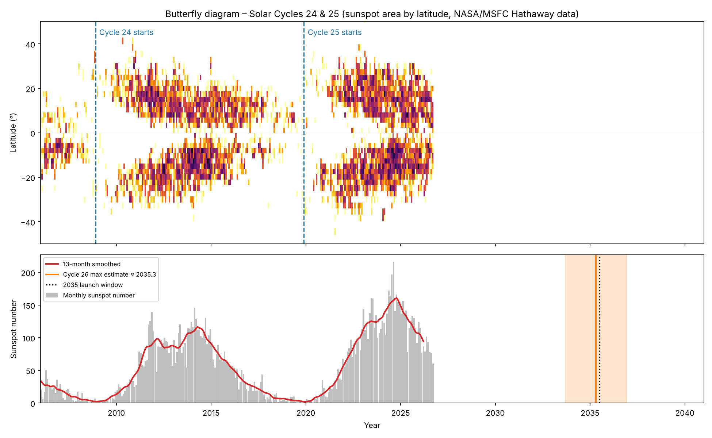
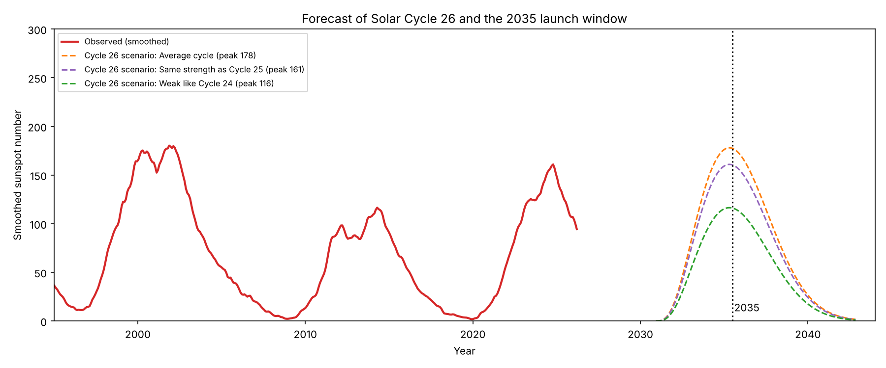

### Key results
| | Value |
|---|---|
| Mean cycle length (Cycles 1–24) | 11.0 ± 1.2 yr |
| Mean rise time (minimum → maximum) | 4.4 ± 1.1 yr |
| Cycle 24 maximum | 2014.3, smoothed SSN 116 |
| Cycle 25 maximum | 2024.8, smoothed SSN 161 (data to Sept 2026; SILSO's last months are provisional) |
| **Cycle 26 minimum (estimate)** | **2030.9 ± 1.2** |
| **Cycle 26 maximum (v1 estimate)** | **2035.3 ± 1.6** (superseded by Part 2: 2035.4 ± 1.2) |

**Conclusion:** the 2035 launch window very likely falls close to the maximum of Solar Cycle 26.
Scenario peak strengths (smoothed SSN): weak like Cycle 24 ≈ 116, like Cycle 25 ≈ 161, historical average ≈ 178.

**Spörer's law** is visible in the data: mean sunspot latitude fell from 24° (2009) to 7° (2019) during Cycle 24, and Cycle 25 restarted at 19° (2020), drifting to 12° by 2026.

Full numbers: [`results_cycles.txt`](results_cycles.txt), [`data/cycles_table.csv`](data/cycles_table.csv).

### Limitations
Timing of the maximum is fairly predictable from statistics; the *strength* is not, so we show scenarios. Better amplitude predictions use the Sun's polar magnetic field near solar minimum (~2030).

### Part 1B – Our own butterfly diagram, and the cycle period read off it (`scripts/butterfly_own.py`)

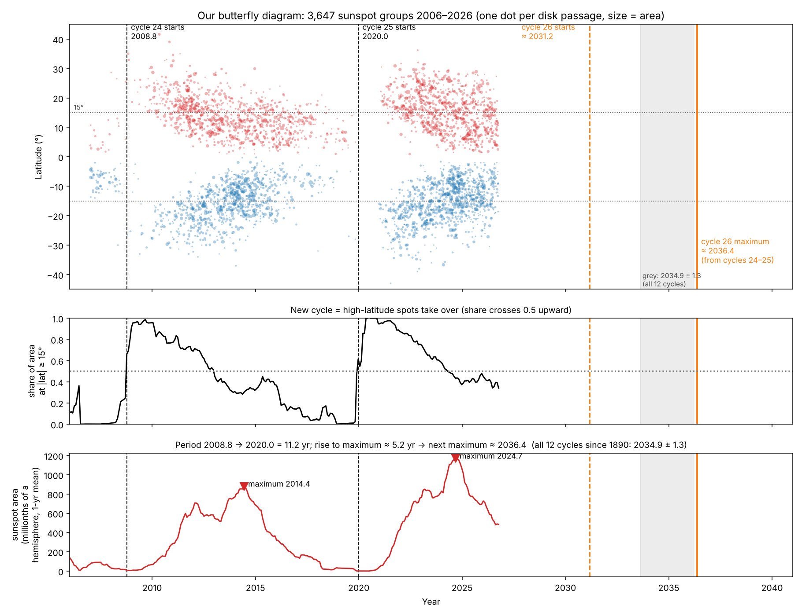

Built directly from the latitude of 3,779 sunspot groups (2006–2026). A cycle starts when more than half of the sunspot area (1-year running total) sits at |latitude| ≥ 15°, after a stretch in which almost all of it was below 15° (starts at least 7 years apart). Maximum = peak of the 1-year mean sunspot area.

- Cycle 24 starts 2008.77, cycle 25 starts 2019.97 (official minima 2008.9 and 2019.9; over 1874–2026 the 14 detected starts differ from the official minima by +0.13 yr on average, 0.6 yr at most).
- **Period of cycle 24: 11.2 yr.** Rise to maximum: 5.67 yr (cycle 24), 4.71 yr (cycle 25).
- **Next maximum from the last two cycles: 2019.97 + 11.20 + 5.19 ≈ 2036.4**; from all 13 complete cycles since 1879: 2034.8 ± 1.2. Both agree with the sunspot-number forecast (2035.4 ± 1.2).
- At maximum the mean spot latitude is 15.5° ± 2.8° (cycle 24: 12.6°, cycle 25: 13.9°) — a marker to watch for in cycle 26.

## Part 2 – Improved forecast (v2): verified data, reliable cycles, analogue ensemble

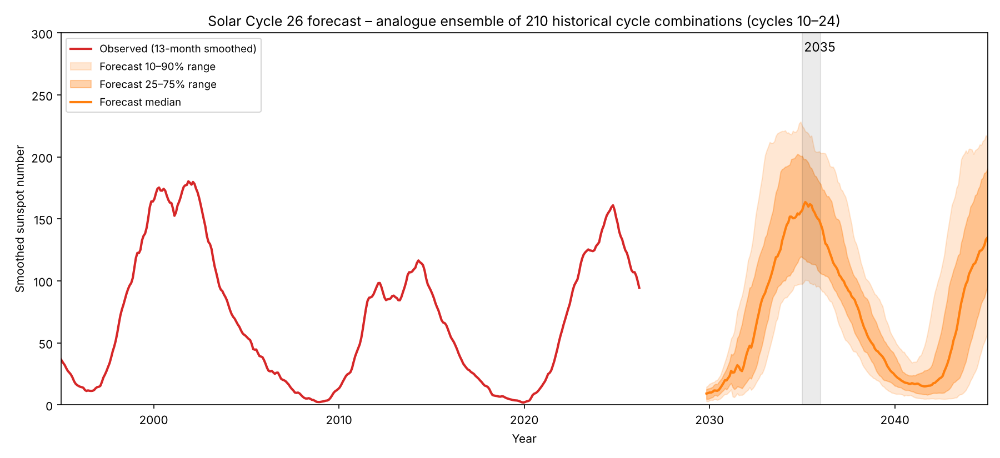

- Hand-typed cycle minima agree with minima found in the data to within 0.23 yr.
- Using only reliable cycles 10–25: length 10.93 ± 0.75 yr, rise 4.17 ± 0.70 yr. Waldmeier effect: corr(peak, rise) = −0.61.
- Two estimators of the Cycle 26 maximum (both use the same 15 historical cycles, so they are not independent): from the Cycle 25 minimum 2035.0 ± 1.2, from the Cycle 25 maximum 2035.8 ± 1.1 (± = spread of the historical values, ~68%; full range 2033.6–2038.1); 77% of the 30 estimates fall in 2034–2036. The spread assumes future cycles behave like past ones; the first high-latitude spots of Cycle 26 (~2029–31) will narrow it.
- Historical-analogue ensemble: 210 combinations of 15 cycle lengths × 14 real cycle shapes, i.e. only ~15 independent pieces of information. 2035 mean SSN median 156, 10–90% 99–210; share of combinations above 100: 88%, above 150: 55%, above 50: 100%. These are scenario frequencies within the 1855–2019 record, not calibrated probabilities: a cycle weaker than any in that record is not covered. Check with all cycles 1–24 (adds the less reliable 1755–1855 cycles, including the weak Dalton-minimum cycles): median 139, above 100: 74%, above 50: 97%. Peak year median 2035.0 (10–90% 2033.7–2036.3).

Details: [`results_forecast_v2.txt`](results_forecast_v2.txt)

## Part 3 – NOAA GOES flares and radio blackouts, 1975–2026

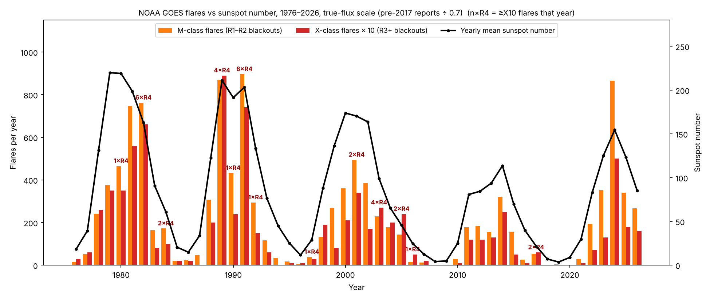
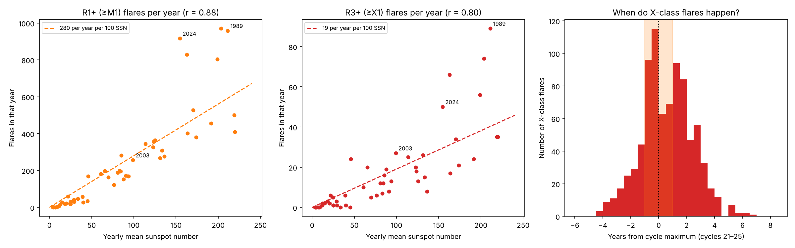

96,840 GOES flares (NCEI legacy reports 1975–2016, GOES-16 2017–2025, GOES-19 2025–2026).

**Flux scale – read this before comparing with official records.** NOAA multiplied GOES-1 to GOES-15 fluxes by 0.7; GOES-16 onwards report the true flux, and flare classes announced in the GOES-16 era use it (14 May 2024: SWPC X8.7, GOES-16 science data X8.7). We divide the legacy fluxes by 0.7, so the whole record is on this **true-flux scale** – the scale on which 2035 alerts will be issued. Official classes and R levels of older events are therefore lower than ours: 6 Sep 2017 was reported as X9.3 / R3, here it is X14.6 / R4. On 120 flares seen by both GOES-15 and GOES-16 (Feb–Jun 2017) we measure a median ratio of 0.64, 8% below NOAA's 0.70, so the results are also shown with 0.64 and on the old scale:

| Scale | Flares per year per 100 SSN: R1+ / R3+ / R4+ | 2035 median: R1+ / R3+ | 6 Sep 2017 flare |
|---|---|---|---|
| True flux, legacy ÷ 0.70 (main) | 280 / 19 / 0.8 | 438 / 30 | X14.6 |
| True flux, legacy ÷ 0.64 (measured ratio) | 298 / 21 / 0.9 | 466 / 33 | X14.6 |
| Old scale (as reported before GOES-16) | 184 / 12 / 0.5 | 287 / 19 | X10.2 (GOES-15 reported X9.3) |

Everything below is on the true-flux scale.

| Radio-blackout level | r with yearly SSN | flares/yr per 100 SSN | 2035 expected (10% / median / 90%) |
|---|---|---|---|
| R1+ (≥M1) | 0.88 | 280 | 277 / 438 / 587 |
| R2+ (≥M5) | 0.82 | 44 | 43 / 68 / 91 |
| R3+ (≥X1) | 0.80 | 19 | 19 / 30 / 40 |
| R4+ (≥X10) | 0.38 | 0.8 | ~1–2 |

- In all 18 past years with SSN ≥ 100 there was at least one R3 event; 39% had an R4 event (true-flux scale).
- When in the cycle? Maximum = peak of the 13-month smoothed sunspot number (for the double-peaked cycle 23, the higher peak, 2001.9). In equal 1-year windows (complete cycles 21–24), X-class flares per cycle-year: 15.5 one to two years before maximum, 41.5 in the year before, 28.8 in the year after, 39.2 one to two years after, 25.8 two to three years after, 12.5 three to four years after. So there are 2.5× more X-class flares 1–2 years after a maximum than 1–2 years before (157 vs 62), and 2.9× more 2–3 years after than 2–3 years before (103 vs 35): risk stays high for about 3 years after the 2035 maximum (e.g. Halloween 2003, Sept 2005, Sept 2017).

Details: [`results_flares.txt`](results_flares.txt), [`data/flares_per_year.csv`](data/flares_per_year.csv)

### Cross-check with reported incidents and look-alike years (`scripts/incidents.py`)

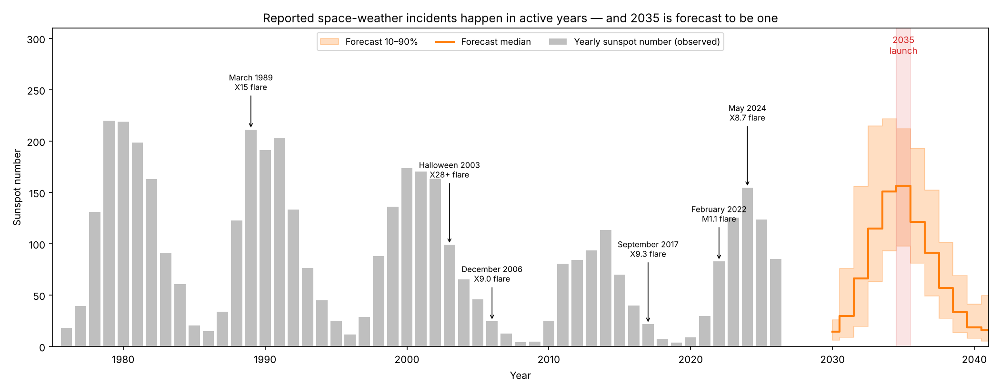

| Incident | Reported then | Level then | Our data (true-flux scale) | Level (true-flux) | Year SSN | From max | What happened |
|---|---|---|---|---|---|---|---|
| March 1989 | X15 | R4 | X21.4 | R5 | 211 | −0.7 yr | Hydro-Québec grid collapse, 6 million without power ~9 h |
| Halloween 2003 | X28+ | R5 | X40.0* | R5 | 99 | +1.9 yr | HF blackouts, polar flights rerouted, WAAS GPS unusable ~30 h, Malmö power cut |
| December 2006 | X9.0 | R3 | X12.9 | R4 | 25 | +5.0 yr | Solar radio burst: GPS receivers on the dayside lose lock |
| September 2017 | X9.3 | R3 | X14.6 | R4 | 22 | +3.4 yr | Hours-long HF blackout during the Caribbean hurricane (Irma) response |
| February 2022 | M1.1 | R1 | M1.1 | R1 | 83 | −2.7 yr | Minor geomagnetic storm: 38 of 49 new Starlink satellites re-enter |
| May 2024 | X8.7 | R3 | X8.7 | R3 | 155 | −0.4 yr | G5 storm: GPS-guided farm machinery disrupted, HF blackouts |

\* GOES saturated near X17 (old scale); X28+ was itself an estimate, so X40 is uncertain – quote "X28+" in the pitch.

Sources: Boteler 2019; NOAA Service Assessment 2004; Cerruti et al. 2008; Redmon et al. 2018; SpaceX 2022, Dang et al. 2022; NOAA SWPC 2024.
Look-alike years (yearly SSN 112–189, the middle half of the 2035 forecast; 12 years since 1978): every one had R3 blackouts (median ~20 per year, range 8–66), 3 of 12 had an R4. Our 2035 forecast (~30 R3, ~440 R1+) is of the same size. Details: [`results_incidents.txt`](results_incidents.txt)

## Part 3B – Geomagnetic storms for a Starlink-like constellation (`scripts/geomagnetic.py`)
The curveball asks for a cost-effective, solar-hardened satellite. We chose a Starlink-like constellation in low Earth orbit. There the main space-weather threat is a geomagnetic storm: it heats and expands the upper atmosphere, so the drag on the satellites rises (February 2022: 38 of 49 new Starlink satellites were lost in a minor G1 storm).

- **Data:** the planetary Kp index from GFZ Potsdam, every 3 hours since 1932 (34,637 days). NOAA G-scale: G1 is Kp 5 … G5 is Kp 9. A Kp level N covers N−, No and N+, so G1 starts at 5− (4.67) and G5 is 9o only (NOAA: "G4: Kp 8, including a 9−"). A storm day is a UT day whose highest Kp reaches the level.
- **Check:** storm days per cycle (cycles 17–24): G1+ 874, G2+ 356, G3+ 127, G4+ 44, G5 3. NOAA's published averages: 900, 360, 130, 60, 4.
- **Link to sunspots** (1932–2025, straight line a + b·SSN): G1+ r = 0.43, G3+ r = 0.68, G4+ r = 0.65. Storms also happen near minimum (fast wind from coronal holes), so the lines do not go through zero, and minor storms follow the sunspot number less closely than X-class flares do (r = 0.80).
- **2035** (median sunspot number 156): about **93 G1+ storm days** (10–90%: 80–106), i.e. one day in four; 17 G3+ days (12–21); 6 G4+ days (4–8); about 0.4 G5 storms. In the 23 real years as active as 2035 (SSN 112–189), 21 had a G4+ storm and 9 a G5 storm.
- **Storms cluster:** in those years 56% of 3-day stretches (31% of 7-day stretches) had no G1+ storm, and 90% of 3-day stretches had no G3+ storm. A deployment can wait for a quiet 3-day forecast.
- **Timing:** unlike X-class flares, storms keep coming after maximum. G3+ storm days per year (average of cycles 17–24): 14.8 in the year before maximum, 13.5 in the year after, 18.8 and 19.2 one to three years after; **2.1× more 1–3 years after maximum than 1–3 years before** (G1+: 1.6×). With the maximum at 2035.4, the stormiest years are 2036–2038, the first years of the constellation.
- **A satellite working 2035–2044** meets about 67 G3+ storms, 25 G4+ storms and 1.8 G5 storms (at least one G5: 84%).
- **Known events:** 13 Mar 1989 Kp 9o (G5), 29 Oct 2003 Kp 9o (G5), 3–4 Feb 2022 Kp 5+ (G1, the Starlink losses), 11 May 2024 Kp 9o (G5).
- **Limitations:** Kp is a global 3-hour index; the drag on a satellite depends on how the upper atmosphere responds at its altitude, which is the next step (an atmosphere model). The straight line against the yearly sunspot number misses part of the declining-phase storms; the timing analysis covers them. 2026 runs to 30 October and is scaled to a full year; the latest Kp values are preliminary.

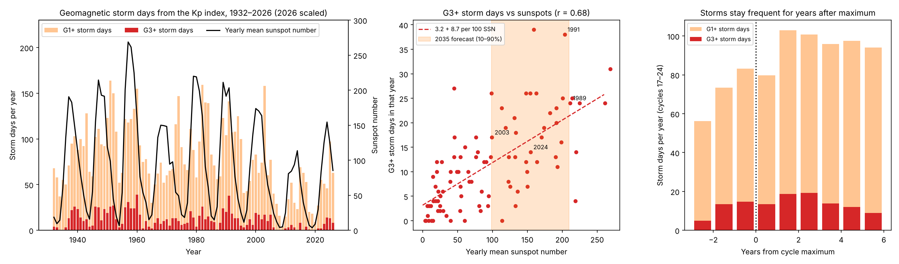

Details: [`results_geomagnetic.txt`](results_geomagnetic.txt)

## Part 3C – Air drag in low Earth orbit (`scripts/drag.py`)
How solar activity and storms change the air density where Starlink-like satellites fly, how fast a satellite sinks, and how much fuel it needs in 2035.

- **Model:** NRLMSIS 2.1 atmosphere model (`pymsis`), density averaged over latitudes ±50° and all local times. Inputs: the F10.7 radio flux, taken from our sunspot forecast with F10.7 = 62.4 + 0.655 × SSN (yearly means 1947–2025, r = 0.989) → 2035: 165 (10–90%: 127–200), solar minimum: 69; and the daily Ap index, the median on days of each G level in the Kp record (quiet 7, G1 22, G2 35, G3 53, G4 89, G5 186).
- **Satellite (assumed, Starlink-like):** 300 kg; ballistic coefficient B = Cd·A/m = 0.01 m²/kg flying edge-on (low-drag safe mode) and 0.1 m²/kg with the solar array facing the flow; circular orbits; lost at 150 km. All survival times scale as 1/B.
- **Check with February 2022:** on the storm day the air at 210 km was 1.38× as dense as in typical 2021 conditions (SpaceX: drag up to 50% higher than during previous launches). The storm itself added only ×1.10; the rest was the rising solar cycle. In safe mode a satellite at 210 km lasts 3–4 days, as the lost satellites did. Using the real 3-hourly ap instead of the daily Ap raises the storm peaks by less than 10%.
- **The solar cycle matters more than single storms:** at 550 km the air on a quiet 2035 day is 14× denser than at solar minimum (350 km: 5×). On top of that a G4 day adds 52%, a G5 day doubles it, and the May 2024 peak (with its higher F10.7) gave 3.7×.
- **A quiet day in 2035 is denser than the storm day that downed the Starlink satellites:** ×1.23 at 210 km, ×1.68 at 350 km.
- **Deployment altitude:** to survive 14 days in safe mode without raising its orbit, a new satellite must start above 265 km on a quiet 2035 day, 280 km during a G5 storm and 290 km in May-2024-like conditions. Deploying at **300 km or higher** in 2035 gives 19–33 days; at 2022's 210 km it gives 2–3 days.
- **Storm days** (Part 3B) cause 29% of the year's drag at 480 km in 2035 (15% at solar minimum).
- **Fuel to stay at one altitude** (300 kg, electric propulsion, Isp 1500 s): at 550 km 5–55 m/s per year (0.1–1.1 kg of fuel); at 480 km 15–150 m/s (0.3–3 kg); at 350 km 120–1,200 m/s (2–23 kg). That is 5–14× more than at solar minimum, but small at 550 km.
- **Silver lining:** a dead satellite at 550 km (tumbling, B = 0.05) falls back in about 1.4 years in 2035-like conditions, but 16 years at solar minimum.
- **Limitations:** the satellite numbers (mass, B, Isp) are assumptions; MSIS is an empirical average model and can miss the densest hours of real storms; real deployment orbits are elliptical and sink more slowly than the circular ones here; each scenario keeps conditions constant; F10.7 comes from the yearly relation (2024 had F10.7 191 at sunspot number 155, so 2035 could be denser than assumed).

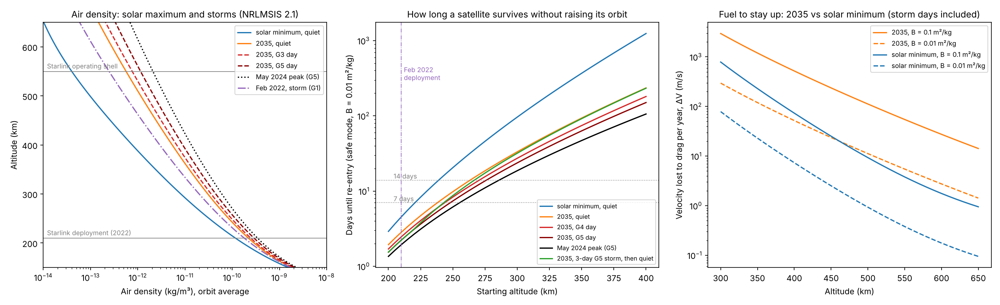

Details: [`results_drag.txt`](results_drag.txt)

## Part 4 – Differential rotation (Steps 1–2): tracking sunspots with trigonometry

**Result:** sidereal rotation rate of sunspots **ω = 14.54 − 2.84 sin²(latitude) °/day** (21,566 tracked sunspot-group passages).
Equator: 24.8 days, 2.04 km/s · 30°: 26.0 days, 1.68 km/s · 40°: 26.9 days, 1.44 km/s. Seen from Earth an active region comes back about every **27 days** and needs about **7 days** to rotate from the east limb to face Earth.

**A. Large sample** (`scripts/rotation.py`): daily positions of sunspot groups 1874–2026 (Greenwich + USAF/NOAA, compiled by D. Hathaway; 260,398 positions). For each disk passage (≥ 4 days within 60° of the central meridian) the Carrington longitude is fitted against time; slope + 14.184 °/day = sidereal rate.

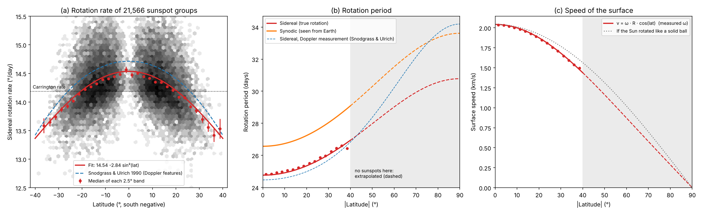

| Latitude | ω (°/day) | Sidereal period | Synodic period (seen from Earth) | Surface speed |
|---|---|---|---|---|
| 0° | 14.54 | 24.8 d | 26.6 d | 2.04 km/s |
| 15° | 14.35 | 25.1 d | 27.0 d | 1.95 km/s |
| 30° | 13.83 | 26.0 d | 28.0 d | 1.68 km/s |
| 40° | 13.36 | 26.9 d | 29.1 d | 1.44 km/s |

Checks: A = 14.536 ± 0.004 (statistical) ± 0.016 (systematic = half the Greenwich–USAF/NOAA difference), B = −2.84 ± 0.05 ± 0.09. Sample: 21,566 passages pass the quality cuts; the fit removes 430 outliers beyond 3σ and uses 21,136 (the two era fits remove their own 220 + 207, hence 12,952 + 8,187 = 21,139). Greenwich era 14.55 − 2.91 sin² vs USAF/NOAA era 14.52 − 2.72 sin²; north 14.535 − 2.87 sin² vs south 14.538 − 2.81 sin²; changing the 60° limit to 45° or 75° moves A by ≤ 0.015 °/day. (An earlier version silently missed 5 of the 153 yearly files – 1879, 1967, 1968, 2006, 2020 – because the server had sent error pages; the download script now checks every file and all numbers here use the complete data.) No sunspots above ~40°, so values there are extrapolations (Doppler measurements give ~34 days at the poles).

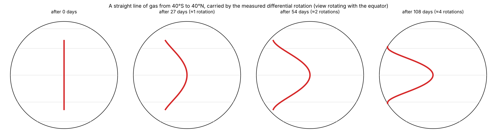

**B. Tracking spots on SDO/HMI images**: 7 daily images, 12–18 Dec 2014 (chosen because B0 ≈ 0 and spots sit at 4°–30°).

*Step by step* (`scripts/manual_walkthrough.py`, the same steps as reading positions with the mouse; whole pixels): on each image read the left/right/top/bottom edge of the disk → centre and radius (e.g. edges 64, 1983, 65, 1984 → centre (1023.5, 1024.5), R = 959.5 px); read the centre of the spot's dark core; convert the time to a Julian Date (JD = 367Y − INT(7(Y + INT((M+9)/12))/4) + INT(275M/9) + D + 1721013.5 + UT/24, e.g. 2014-12-12 23:59:40 UT → 2457004.49977). Records for spot A (NOAA 12236, +30°) and spot E (NOAA 12235, −8°), also in [`data/rotation/manual_walkthrough.csv`](data/rotation/manual_walkthrough.csv):

| Spot | Time (UT) | Julian Date | x (px) | y (px) | Disk centre (px) | Disk radius (px) |
|---|---|---|---|---|---|---|
| A | 2014-12-12 23:59:40 | 2457004.49977 | 302 | 553 | (1023.5, 1024.5) | 959.50 |
| A | 2014-12-13 23:59:40 | 2457005.49977 | 413 | 548 | (1023.5, 1024.0) | 959.25 |
| A | 2014-12-14 23:59:40 | 2457006.49977 | 553 | 542 | (1023.5, 1024.0) | 959.25 |
| A | 2014-12-15 23:59:40 | 2457007.49977 | 718 | 535 | (1023.0, 1024.0) | 959.00 |
| A | 2014-12-16 23:59:40 | 2457008.49977 | 898 | 532 | (1023.0, 1024.5) | 959.25 |
| A | 2014-12-17 23:59:40 | 2457009.49977 | 1082 | 528 | (1024.0, 1024.5) | 959.25 |
| E | 2014-12-11 23:59:40 | 2457003.49977 | 296 | 1149 | (1024.0, 1024.5) | 959.25 |
| E | 2014-12-12 23:59:40 | 2457004.49977 | 455 | 1147 | (1023.5, 1024.5) | 959.50 |
| E | 2014-12-13 23:59:40 | 2457005.49977 | 643 | 1144 | (1023.5, 1024.0) | 959.25 |
| E | 2014-12-14 23:59:40 | 2457006.49977 | 852 | 1143 | (1023.5, 1024.0) | 959.25 |
| E | 2014-12-15 23:59:40 | 2457007.49977 | 1069 | 1142 | (1023.0, 1024.0) | 959.00 |
| E | 2014-12-16 23:59:40 | 2457008.49977 | 1283 | 1145 | (1023.0, 1024.5) | 959.25 |
| E | 2014-12-17 23:59:40 | 2457009.49977 | 1486 | 1143 | (1024.0, 1024.5) | 959.25 |

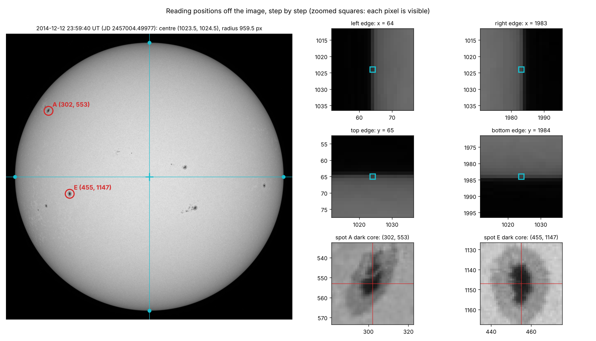

*Two trigonometric methods* (`scripts/manual_rotation.py`):
1. arcsin: latitude = arcsin(Y), central-meridian distance = arcsin(X / cos lat), with X = (x − xc)/R, Y = −(y − yc)/R; it grows linearly in time, slope = synodic rate.
2. sine fit: x(t) = xc + R cos(lat) · sin(2π(t − t₀)/P); y(t) stays ~constant.

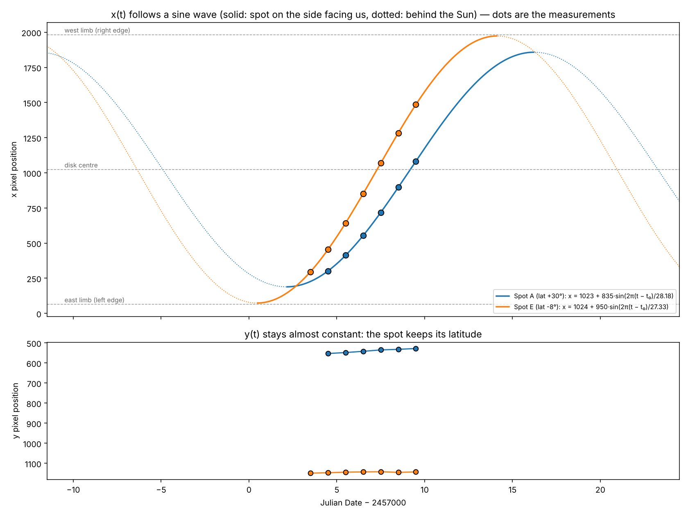

| Spot | Sine fit (t in JD) | P_syn arcsin / sine | ω sidereal | P sidereal | Speed across disk / true |
|---|---|---|---|---|---|
| A (+29.5°) | x = 1023.4 + 834.6·sin(2π(t − 2457009.18)/28.18) | 28.35 / 28.18 d | 13.79 °/d | 26.10 d | 186 px/d = 1.56 km/s / 1.69 km/s |
| E (−8.0°) | x = 1023.5 + 949.9·sin(2π(t − 2457007.29)/27.33) | 27.32 / 27.33 d | 14.19 °/d | 25.37 d | 218 px/d = 1.83 km/s / 1.98 km/s |

The sine fits leave 0.5 px residuals. The amplitude is fixed to R·cos(lat): with only ~1/5 of a rotation observed, fitting amplitude and period together is unstable.

*Automatic tracking of 9 spots* (`scripts/track_sdo.py`, sub-pixel positions, circle fit to the limb; without the PNG originals it uses the JPG copies in `data/sdo/`, which give the same rates within 0.01 °/day):

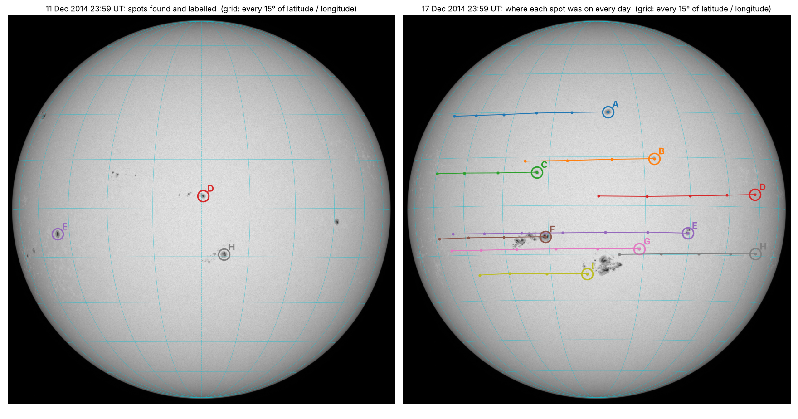
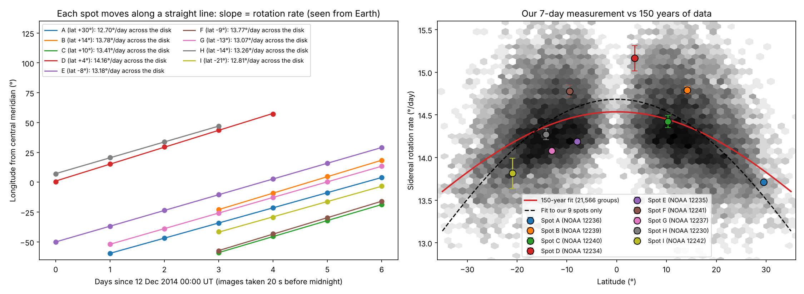
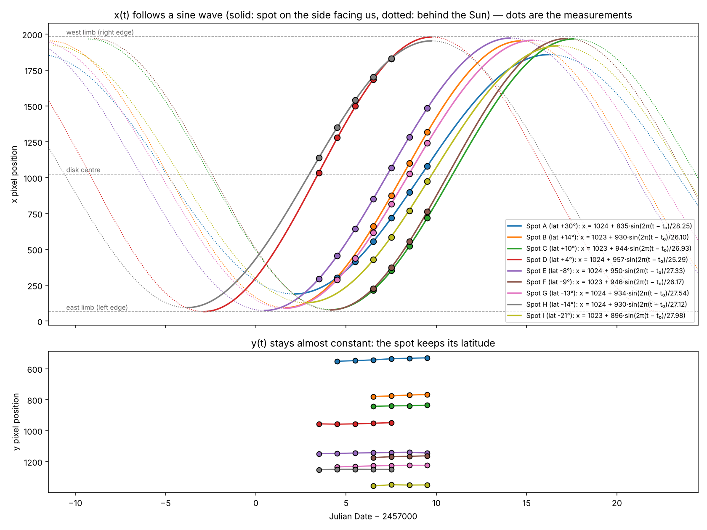

| Spot | NOAA | Latitude | Days | ω sidereal (°/day) | 150-yr law | P_syn arcsin / sine fit (d) | P sidereal (d) | Speed (km/s) |
|---|---|---|---|---|---|---|---|---|
| A | 12236 | +29.5° | 6 | 13.71 ± 0.01 | 13.85 | 28.34 / 28.25 | 26.26 | 1.68 |
| B | 12239 | +14.2° | 4 | 14.79 ± 0.04 | 14.37 | 26.12 / 26.10 | 24.34 | 2.02 |
| C | 12240 | +10.3° | 4 | 14.42 ± 0.07 | 14.45 | 26.84 / 26.93 | 24.96 | 1.99 |
| D | 12234 | +3.6° | 5 | 15.17 ± 0.15 | 14.53 | 25.43 / 25.29 | 23.74 | 2.13 |
| E | 12235 | −8.0° | 7 | 14.19 ± 0.01 | 14.48 | 27.32 / 27.33 | 25.38 | 1.97 |
| F | 12241 | −9.4° | 4 | 14.78 ± 0.07 | 14.46 | 26.15 / 26.17 | 24.36 | 2.05 |
| G | 12237 | −13.1° | 6 | 14.08 ± 0.01 | 14.39 | 27.55 / 27.54 | 25.57 | 1.93 |
| H | 12230 | −14.2° | 4 | 14.27 ± 0.06 | 14.37 | 27.14 / 27.12 | 25.22 | 1.94 |
| I | 12242 | −20.9° | 4 | 13.81 ± 0.18 | 14.17 | 28.12 / 27.98 | 26.06 | 1.81 |

- Our latitudes agree with NOAA's to 0.7° on average; arcsin and sine-fit periods agree within 0.14 d for all 9 spots.
- Spots scatter around the 150-year law by 0.36 °/day (mean offset +0.02) — the same as single groups in the long record (0.50 °/day). A fit to the 9 spots alone gives 14.68 ± 0.17 − (4.70 ± 1.69) sin²: one week shows differential rotation, only a large sample measures it precisely.
- A systematic error found and fixed: the first version took the disk edge at half the central brightness, but the limb itself is only ~45% as bright (limb darkening), so the radius came out 954.6 px instead of 959.2 px. That made rates ~0.1 °/day too fast; after the fix the mean offset from the 150-year law fell from +0.12 to +0.02 °/day.

**C. Deriving the equation, and its assumptions** (`scripts/rotation.py`, `scripts/rotation_equation.py`)

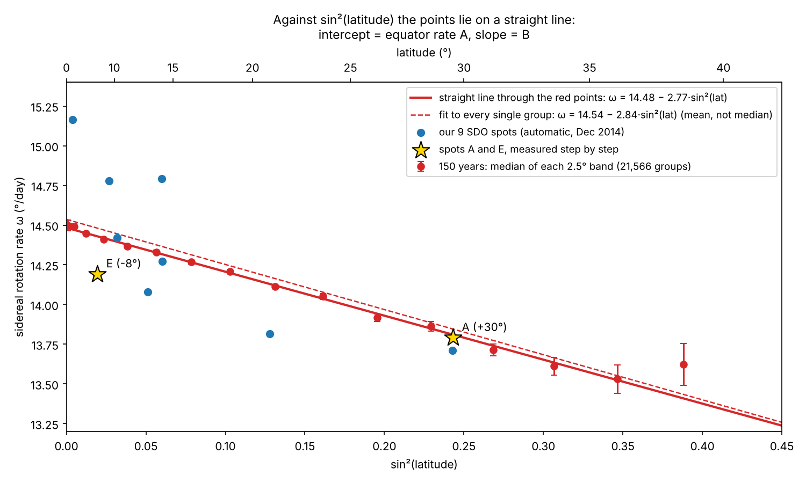

1. **One rotation rate per tracked spot.** For every disk passage, the trigonometry of Part B gives the spot's longitude each day; the slope of longitude against time is its rate seen from Earth, and adding Earth's orbital motion gives the true (sidereal) rate ω. Doing this for 21,566 sunspot-group passages (1874–2026) gives 21,566 pairs (latitude φᵢ, rate ωᵢ); our own 9 SDO spots give 9 more.
2. **Choose the form.** The Sun is north–south symmetric (+φ and −φ rotate alike), so only even powers of sin φ can appear. The simplest such form, and the standard one in solar physics, is ω = A + B·sin²φ.
3. **Make it a straight line.** With s = sin²φ the model becomes ω = A + B·s. Plotted against s, the band medians (red dots above) do lie on a straight line.
4. **Least squares (linear regression).** B = Σ(sᵢ − s̄)(ωᵢ − ω̄) / Σ(sᵢ − s̄)², A = ω̄ − B·s̄ (A is the rate at the equator, s = 0). Fitted to all single groups after removing 430 outliers beyond 3 standard deviations (21,136 left); errors from 200 bootstrap resamples.
5. **Result: A = 14.536 ± 0.004 (stat.) ± 0.016 (syst.) °/day, B = −2.84 ± 0.05 (stat.) ± 0.09 (syst.) °/day → ω(φ) = 14.54 − 2.84 sin²φ °/day.** Systematic = half the difference between the Greenwich and USAF/NOAA datasets.
   - A line through the 2.5°-band medians gives 14.48 − 2.77 sin²φ: the distribution of single groups is skewed (young groups rotate fast), so its mean sits a little above its median.
   - Adding a C·sin⁴φ term gives C = −0.04 ± 0.41, i.e. zero: within ±40° the sin²φ term is enough.
   - Our 9 SDO spots alone give 14.68 ± 0.17 − (4.70 ± 1.69) sin²φ: same trend, much larger error.
6. **Period and speed.** P(φ) = 360/ω(φ) days. The surface speed is the angular rate times the radius of the latitude circle: v = ω·(π/180)/86400 · R☉·cos φ, so **v(φ) = 2.043 · cos φ · (1 − 0.195 sin²φ) km/s** (2.04 km/s at the equator, 1.95 at 15°, 1.68 at 30°).

Assumptions:
1. The Sun is a perfect sphere.
2. It is seen from far away (orthographic projection). In reality we see slightly less than a hemisphere: 0.27° at the limb, negligible.
3. Spots move only with the surface, at a constant rate over a few days. Not exactly true for single spots (e.g. spot D), hence the large sample.
4. Rotation depends only on latitude and is north–south symmetric, so it can be written as A + B·sin²φ.
5. Images have solar north up (P = 0); checked against NOAA latitudes (0.7° mean difference).
6. B0 = 0 in the simple formulas (B0 was −0.5° to −1.3° on our dates); the full method includes B0.
7. Earth's orbital motion is 0.9856 °/day for synodic → sidereal (truly 0.953–1.019, at most ±0.03 °/day); the full method uses the exact value.
8. R☉ = 695,700 km (IAU nominal value).
9. Image times are exact (SDO time stamps, to the second).
10. The equation is valid only within ±40° latitude, where sunspots exist.

Details: [`results_rotation.txt`](results_rotation.txt), [`results_sdo_tracking.txt`](results_sdo_tracking.txt), [`results_manual_walkthrough.txt`](results_manual_walkthrough.txt), [`results_sine_fit_all.txt`](results_sine_fit_all.txt), [`results_rotation_equation.txt`](results_rotation_equation.txt)

## Part 5 – Protection strategy and the curveball: a Starlink-like constellation in 2035
ISECG launches in 2035 whatever our forecast says (curveball). We protect a Starlink-like constellation in low Earth orbit with layers of cheap measures, each tied to a number from our analyses, plus tools and a playbook for the people who operate it.

### 5A – Radiation storms: solar proton events (`scripts/protons.py`)
- **Data:** NOAA's list of proton events (≥ 10 pfu at > 10 MeV) 1976–2017, stored as `data/sep_list.html`: 264 events (S1 151, S2 71, S3 33, S4 9). Per cycle at each level: S1 38, S2 18, S3 8, S4 2; NOAA's published averages are 50, 25, 10, 3.
- **Link to sunspots** (events per year per 100 sunspots, line through zero as for flares): S1+ 7.0 (r = 0.74), S3+ 1.1 (r = 0.48), S4+ 0.24 (r = 0.36).
- **2035:** about 11 proton events (10–90%: 7–15), 1.7 strong S3+ (1.1–2.3) and 0.4 severe S4. All 9 past years as active as 2035 had at least one event; 7 of 9 had an S3+.
- **Big events also come in quiet years:** 1994, 2005, 2006 and 2017 had S3+ events at sunspot numbers of only 22–46, so timing alone cannot avoid them.
- **Where they start:** 85% of the events with a known source began between E30 and W90 (65% in the western half). This is the danger zone used by the region calendar (5B). The five largest started within 30° of the disk centre.
- **A satellite working 2035–2044** meets about 8 S3+ events and 1.7 S4 events (at least one S4: 82%).
- In low Earth orbit the Earth's magnetic field keeps most solar protons out except over the polar regions, so radiation is handled by the satellite layer (vault and redundancy, 5C), not by thick shielding.
- **Limitations:** NOAA's preliminary listing ends in 2017, merges close proton increases into one event and was measured by GOES detectors that were not cross-calibrated.

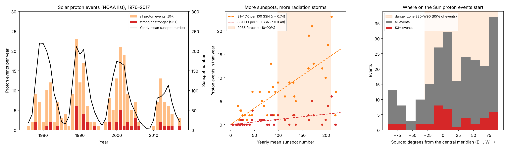

### 5B – Tools for operational readiness
1. **Risk calendars** (years): X-class flares per year 2030–2041 (`figures/video/v12_risk_calendar.png`), storms around maximum (Part 3B), proton events (5A).
2. **Active-region calendar** (`scripts/region_calendar.py`, weeks): from one look at a region (its latitude and distance from the central meridian), our rotation law gives when it enters the danger zone, faces Earth, leaves the disk and comes back. `python3 scripts/region_calendar.py 2035-06-01 -15 -60` prints the calendar for a region at 15°S, 60° east of the central meridian on 1 June 2035.
   - **Check with NOAA 13664**, the region behind the May 2024 G5 storm: predicted from its first day on the disk (2 May) only, all seven dates — including its return as NOAA 13697 a month later — were right to within 0.7 days, up to 38 days ahead. The predicted danger window (4–13 May) contains 8–9 May, when the CMEs behind the storm left the Sun.
3. **Quiet-window rule** (days): deploy only into a forecast 3-day quiet window. In years like 2035, 56% of 3-day stretches had no G1+ storm (Part 3B).
4. **Deployment altitude and fuel** (Part 3C): at least 300 km in 2035; about 1 kg of fuel a year at 550 km.

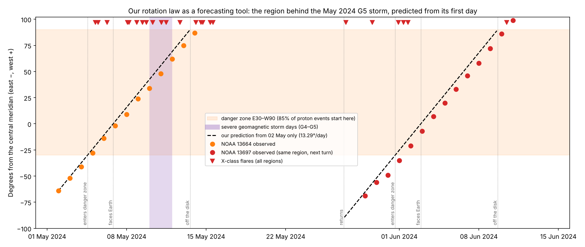

### 5C – Five protection layers
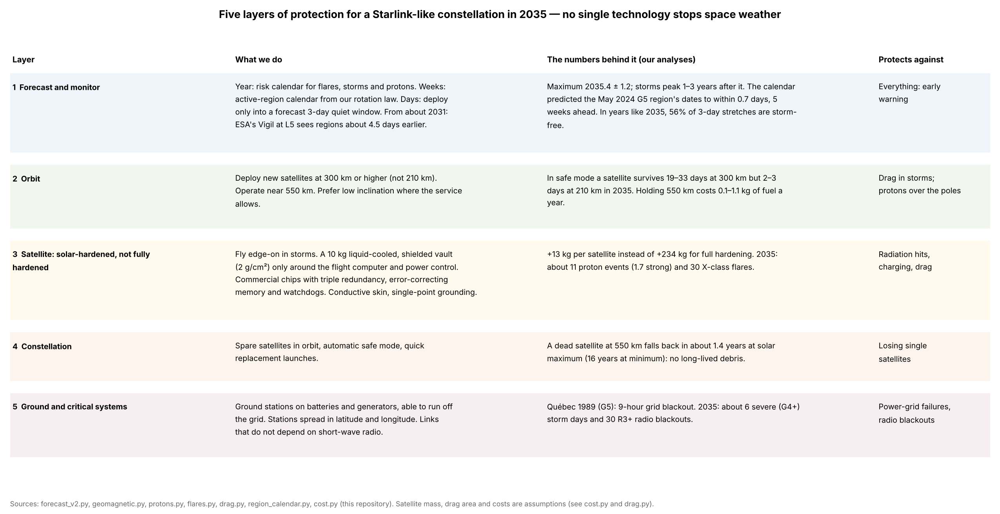

### 5D – Response playbook
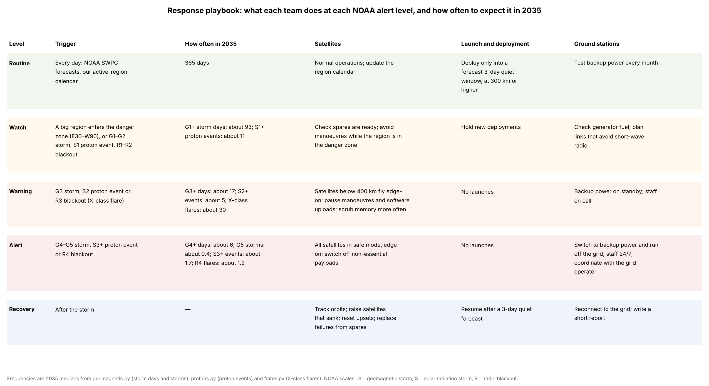

### 5E – Cost-effectiveness (`scripts/cost.py`)
All inputs are assumptions, with a low and a high value: 4,000 satellites with a 5-year life (800 new a year, 50 per launch), 300 kg, $0.8M each (0.5–1.5), launch $2,500 per kg (1,500–5,000), radiation-hardened electronics +$1M per satellite (0.5–3), our extra parts $50k (20–100k), a space-weather desk $2M a year (1–5).
- **Full-scale hardening** (2 g/cm² over the whole 11.7 m² body and hardened electronics): +234 kg per satellite (+78%), about $1.3 billion a year (0.7–3.3), 1.3% of the $100 billion system every year.
- **Our layers:** +13 kg per satellite (+4%: the 10 kg vault, a spare computer and grounding), deploying at 300 km instead of 210 km (53 m/s more from the upper stage, 1.9% less payload) and the operations desk: about **$80M a year (40–160), 0.08% of the system, 6% of the cost of full hardening**.
- **One lost batch** (50 satellites and their launch) costs about $78M (48–150), so a whole year of our layers costs about one lost batch. With 2022 practice in a year like 2035, about 9 of the 16 batches a year would meet a G1+ storm in their first five days, and at 210 km every 2035 day has denser air than the day of the 2022 losses. The layers pay for themselves if they save one batch a year.
- **Full-scale radiation hardening would not have saved the February 2022 satellites:** they were lost to drag, not radiation.

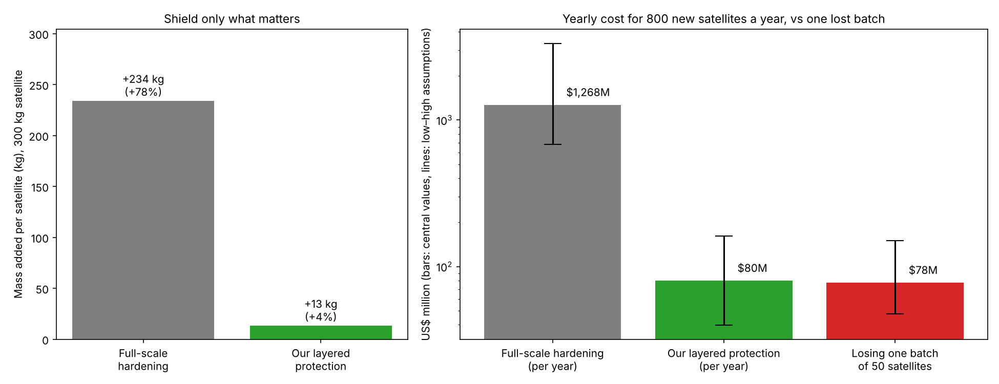

### 5F – Our decision and checkpoints
ISECG launches in 2035. **Our recommendation: go, with the five layers and the playbook** — deploy at 300 km or higher in a forecast quiet window, operate near 550 km, keep spares in orbit. Checkpoints:
- **2029–2031:** look for the first high-latitude spots of cycle 26 (our butterfly method) to confirm the timing.
- **About 2030:** estimate the cycle's strength from the Sun's polar magnetic field and adjust the margins.
- **From about 2031:** add the side view from ESA's Vigil.
- **A month before each launch campaign:** run the region calendar.
- **On the day:** follow the playbook.

Limitations: the cost inputs are assumptions with wide ranges; the loss comparison rests on one historical event; the region calendar uses the average rotation law for a region's latitude (single regions scatter around it by about 0.4°/day, Part 4).

The 5-minute video outline (in Chinese, with English narration): [`docs/video_outline_zh.md`](docs/video_outline_zh.md)

## Video and slide figures (`scripts/video_figures.py`)
Fifteen 16:9 figures (1920×1080, English) in `figures/video/`, ready for the video and the slides. Every number on them is read from the data and result files, so they follow any rerun. Before saving, the script checks that no text overlaps or runs off the frame (`results_video_figures.txt`).

| Figure | Shows |
|---|---|
| `v01_cover.png` | Title slide with an SDO/HMI image |
| `v02_incidents.png` | Yearly sunspot number 1976–2026, our forecast to 2041 and six reported incidents |
| `v03_butterfly.png` | Our butterfly diagram: 11.2-year period, cycle 26 starts ≈ 2031, next maximum 2035–2036 |
| `v04_forecast.png` | Forecast: maximum 2035.4 ± 1.2, 2035 sunspot number 156 (99–210) |
| `v05_step1_measure.png` | Step 1: disk edges, centre and radius; pixel positions and Julian Date of spots A and E |
| `v06_step2_trigonometry.png` | Step 2, method 1: the arcsin formulas worked through for spot A (26.1-day true rotation) |
| `v07_step2_sine_fit.png` | Step 2, method 2: sine fits of x(t) (true rotation: A 26.1 d, E 25.4 d) |
| `v08_step2_equation.png` | Step 3: ω against sin²φ is a straight line → ω = 14.54 − 2.84 sin²φ, period and speed |
| `v09_rotation_meaning.png` | What the rotation law means for launch planning: a region returns every ~27 days, ~7 days from the east limb to facing Earth |
| `v10_flares_vs_sunspots.png` | X-class flares vs sunspot number: ~19 per year per 100 sunspots → ~30 in 2035 |
| `v11_after_maximum.png` | X-class flares per year around solar maximum (cycles 21–24) |
| `v12_risk_calendar.png` | Expected X-class flares per year, 2030–2041 |
| `v13_2035_in_numbers.png` | Six key numbers for 2035 |
| `v14_storms_after_maximum.png` | Geomagnetic storms peak 1–3 years after maximum (cycles 17–24); ~93 G1+ storm days in 2035 |
| `v15_leo_2035_in_numbers.png` | Six numbers for a Starlink-like constellation in 2035 |

## Data sources
- Monthly sunspot number: WDC-SILSO, Royal Observatory of Belgium, Brussels – https://www.sidc.be/SILSO/datafiles (`SN_m_tot_V2.0.csv`)
- Sunspot area by latitude (butterfly data) and daily sunspot-group positions (Greenwich/RGO 1874–1976, USAF/NOAA 1977–2026): D. Hathaway – http://solarcyclescience.com/AR_Database/ (`bflydata.txt`, `gYYYY.txt`; also at https://solarscience.msfc.nasa.gov/greenwch.shtml)
- Solar flares: NOAA NCEI GOES XRS flare reports 1975–2017 – https://www.ngdc.noaa.gov/stp/space-weather/solar-data/solar-features/solar-flares/x-rays/goes/xrs/ ; GOES-16 / GOES-19 XRS L2 flare summaries 2017–2026 – https://data.ngdc.noaa.gov/platforms/solar-space-observing-satellites/goes/
- Geomagnetic Kp index: GFZ Helmholtz Centre for Geosciences, Potsdam – https://kp.gfz-potsdam.de (`Kp_ap_Ap_SN_F107_since_1932.txt`)
- Solar proton events 1976–2017: NOAA SWPC preliminary listing – https://umbra.nascom.nasa.gov/SEP/ (stored as `data/sep_list.html`)
- Solar images: SDO/HMI continuum via the Helioviewer API – https://api.helioviewer.org (viewer: https://helioviewer.org)
- Exact download commands: [`scripts/download_data.sh`](scripts/download_data.sh)

## References (methods)
- Meeus, J. 1998, *Astronomical Algorithms*, 2nd ed., ch. 25 and 29 (solar ephemeris: B0, L0, P)
- Hathaway, D., Wilson, R. & Reichmann, E. 1994, Solar Physics 151, 177 (shape of the sunspot cycle)
- Snodgrass, H. & Ulrich, R. 1990, ApJ 351, 309 (rotation of Doppler features)
- Balthasar, H., Vázquez, M. & Wöhl, H. 1986, A&A 155, 87 (sunspot-group rotation from Greenwich data)
- Matzka, J. et al. 2021, Space Weather 19, e2020SW002641 (the Kp index)
- Emmert, J. T. et al. 2021, Earth and Space Science 8, e2020EA001321 (NRLMSIS 2.0; we use version 2.1 through `pymsis`)

## Reproduce
All scripts find `data/` and `figures/` relative to the repository, so they run wherever it is cloned.
```bash
pip install -r requirements.txt      # versions used for the results (Python 3.13)
bash scripts/download_data.sh        # raw flare and sunspot-group files (~60 MB) are not stored in the repo
bash scripts/run_all.sh              # runs every script below in order and rewrites results_*.txt
```
Or one by one:
```bash
python3 scripts/cycles.py            # Part 1
python3 scripts/forecast_v2.py       # Part 2
python3 scripts/flares.py            # Part 3 (needs forecast_v2 output)
python3 scripts/rotation.py          # Part 4A
python3 scripts/track_sdo.py         # Part 4B (downloads the SDO images; needs rotation.py output)
python3 scripts/manual_walkthrough.py               # Part 4B: spots A and E step by step
python3 scripts/manual_rotation.py my_spots.csv out.png   # your own hand measurements, both methods
python3 scripts/rotation_equation.py # Part 4C
python3 scripts/butterfly_own.py     # Part 1B
python3 scripts/incidents.py         # Part 3 cross-check (needs flares.py output)
python3 scripts/geomagnetic.py       # Part 3B (needs cycles.py and forecast_v2.py output)
python3 scripts/drag.py              # Part 3C (needs geomagnetic.py output)
python3 scripts/protons.py           # Part 5A
python3 scripts/region_calendar.py   # Part 5B check (May 2024); or: region_calendar.py 2035-06-01 -15 -60
python3 scripts/cost.py              # Part 5E (needs geomagnetic.py output)
python3 scripts/strategy_figures.py  # Part 5C-5D tables (needs the scripts above)
python3 scripts/video_figures.py     # 16:9 figures for the video and slides (figures/video/)
python3 scripts/solar_geometry.py    # self-test against SunPy (pip install sunpy)
```
