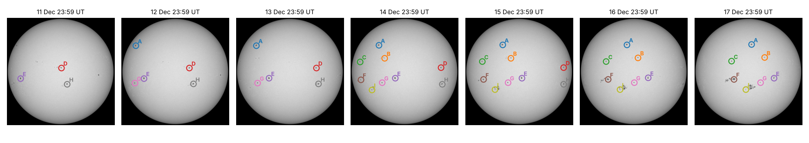

# Planet Hack 2026 高年级挑战（G9–Y12）中文说明

**挑战内容：** 用真实数据预测 2035 年发射窗口期间的太阳活动，并为航天任务设计防太阳风暴的方案。

## 对照挑战要求

| # | 要求 | 状态 | 在哪里 |
|---|---|---|---|
| 1 | 用一系列 SDO/HMI 图像追踪至少两个纬度明显不同的黑子，记录 x、y 像素坐标和儒略日 | ✅ | 第八部分第 2 小节：黑子 A（+30°）和 E（−8°）逐步测量，记录表里有儒略日；另外自动追踪了 9 个黑子 |
| 2 | 用三角函数求每个纬度的自转周期；画 x、y 随时间的图，拟合正弦曲线，估计运动速率 | ✅ | 第八部分第 3、4、6 小节：arcsin 方法和正弦拟合两种方法，9 个黑子都算出了周期 |
| 3 | 量化较差自转，推导速度和纬度的方程，写清假设 | ✅ | 第八部分第 5、8 小节：ω = 14.54 − 2.84 sin²φ，v = 2.04 cos φ (1 − 0.195 sin²φ) km/s，10 条假设 |
| 4 | 用黑子纬度数据自己画最近两个周期的蝴蝶图，用它估计周期，找出下一个极大期 | ✅ | 第一部分"自己画的蝴蝶图"：周期 11.2 年，下一个极大期约 2036.4 年（用全部 13 个周期：2034.8 ± 1.2 年） |
| 5 | 预测 2035 年的太阳活动，并和历史上"太阳活动与无线电中断"的关系对照 | ✅ | 第四、五部分：2035 年黑子数中位数 156，每年约 30 次 R3 级中断（真实通量口径）；6 个真实事件和 12 个类似年份对照 |
| 6 | 提出任务防护方案 | ✅ | 第十一部分：发射时机（平静窗口、活动区日历）、轨道（部署 ≥ 300 km，工作约 550 km）、硬件（保险箱和冗余）、地面站（离网供电） |
| 7 | 用视频向 ISECG 评审团陈述，展示数学和蝴蝶图，说出你的决定 | ⏳ | 视频大纲和台词（[`video_outline_zh.md`](video_outline_zh.md)）、视频用图（第十部分）都已做好，由队员录制 |
| 8 | Curveball：不管预测都在 2035 年发射，设计经济的抗太阳风暴卫星，避免全面加固 | ✅ | 近地轨道星座（类似 Starlink）：地磁暴（第五部分之二）、大气阻力（之三）、质子事件、五层防护和成本（第十一部分）。每颗卫星只重 13 kg（全面加固要 234 kg），成本约为全面加固的 6% |
| 9 | 第二次工作坊的"风险识别"：为 2035 年准备运行和应对工具，分层防护 | ✅ | 第十一部分：风险日历、活动区日历工具、平静窗口规则、五层防护、应对手册 |

本文档包括：

0. [对照挑战要求](#对照挑战要求)
1. [蝴蝶图怎么看](#一蝴蝶图怎么看)
2. [第一版预测是怎么做的](#二第一版预测cyclespy是怎么做的)
3. [第一版的局限](#三第一版的局限)
4. [改进版预测（v2）](#四改进版预测forecast_v2py)
5. [NOAA 耀斑统计和无线电中断验证](#五noaa-耀斑统计和无线电中断验证flarespy)
   - [地磁暴统计（第五部分之二）](#五之二地磁暴统计geomagneticpy)
   - [大气阻力（第五部分之三）](#五之三大气阻力dragpy)
6. [几个概念和火箭发射的关系](#六几个概念和火箭发射的关系)
7. [还能怎么改进](#七还能怎么改进)
8. [第 1、2 步：测量太阳的较差自转](#八第-12-步测量太阳的较差自转)
9. [外部评审意见和我们的处理](#九外部评审意见和我们的处理)
10. [视频和幻灯片用图](#十视频和幻灯片用图video_figurespy)
11. [防护方案和 curveball（第 5 步）](#十一防护方案和-curveball第-5-步)

---

## 一、蝴蝶图怎么看


**上半部分是蝴蝶图：**
- 横轴是时间，纵轴是太阳纬度：0° 是赤道，正数是北半球，负数是南半球。
- 每一小格代表一个卡林顿自转周期（约 27 天）里、某个纬度带上的黑子总面积。颜色越深，黑子面积越大；空白就是没有黑子。
- 数据来自 NASA 的 Hathaway 黑子数据库，原始观测来自格林尼治天文台和美国空军/NOAA。

**从图上能读出的四个规律：**

1. **每个周期都是一对"翅膀"。** 周期刚开始时，黑子出现在 ±25° 到 30° 左右；随着周期推进，黑子出现的纬度越来越靠近赤道；周期结束时，黑子在 ±5° 到 10° 附近消失。北半球和南半球各画出一个向赤道收拢的"V"形，合起来就像蝴蝶的翅膀。这就是**斯波勒定律**。数据验证：第 24 周期黑子的平均纬度从 2009 年的 24° 降到 2019 年的 7°；第 25 周期在 2020 年从 19° 重新开始，到 2026 年降到了 12°。

2. **新旧周期会重叠。** 2019 到 2020 年前后，赤道附近还有第 24 周期的最后几个黑子，高纬度已经出现了第 25 周期的第一批黑子。**高纬度出现新黑子，就是新周期开始的标志。**

3. **黑子几乎不会出现在 40° 以上，也很少正好出现在赤道。** 黑子只在两条"活动带"里出现。

4. **南北半球不完全同步。** 第 24 周期北半球的黑子比南半球出现得早，南半球的高峰来得更晚。这也是第 24 周期在 2012 年和 2014 年出现**两个峰**（下半部分的红线）的原因之一。

**下半部分：** 灰色柱子是每月黑子数，红线是 13 个月平滑值。橙色竖线和阴影是第一版预测的第 26 周期极大期（2035.3 ± 1.6 年），黑色虚线是 2035 年。

**物理原因：** 太阳赤道转得比两极快（较差自转），会把磁场线拉伸、缠绕。磁场最强的区域会慢慢从中纬度向赤道迁移，黑子就沿着这条路线冒出来，所以画出了蝴蝶的形状。

**对预测的作用：** 大约 2029 到 2031 年，高纬度（约 ±30°）一旦开始出现第 26 周期的黑子，就能确定第 26 周期开始了，可以用来更新 2035 年的预测。

### 自己画的蝴蝶图，并从图上量出周期（`butterfly_own.py`）


上面那张图用的是 NASA 已经按纬度分好格的数据。这张是我们**直接用每个黑子群的纬度**画的：2006 到 2026 年的 3,779 个黑子群，每个点是一个黑子群"过日面"一次，点越大黑子面积越大，红色是北半球，蓝色是南半球。

**从图上量周期的方法：**
- 旧周期快结束时，黑子都在赤道附近（低于 15°）；新周期的黑子从高纬度（15° 以上）冒出来。
- 每个卡林顿自转周期（约 27 天）统计一次：15° 以上的黑子面积占总面积多少，按一年滑动累计（中间那张图）。
- **占比从低于 0.3 回升、越过 0.5 的时刻，就是新周期的开始。** 另外规定两个开始点至少相隔 7 年（历史上最短的周期也有 9 年），用来排除周期高峰附近的假信号。
- 两个开始点之间的时间就是周期长度。黑子总面积（下图）最高的时刻就是极大期。

**结果：**
- **从图上读出的周期开始时间：** 第 24 周期 **2008.77**，第 25 周期 **2019.97**，和官方（SILSO）公布的极小期 2008.9、2019.9 几乎一样。把这个方法用到 1874 年以来的全部数据，找出的 14 个开始时间和官方极小期平均只差 0.13 年，最多差 0.6 年。
- **第 24 周期长度：** 2019.97 − 2008.77 = **11.2 年**。
- **从开始到极大期：** 第 24 周期 5.67 年（极大期 2014.45），第 25 周期 4.71 年（极大期 2024.68），平均 5.19 年。
- **只用最近两个周期推算：** 第 26 周期大约在 2019.97 + 11.20 = **2031.2 年**开始，极大期约在 2031.2 + 5.19 = **2036.4 年**。
- **用 1879 年以来全部 13 个完整周期推算：** 周期 10.83 ± 0.75 年，上升时间 4.03 ± 0.92 年，极大期约在 **2034.8 ± 1.2 年**（图里的灰色带）。
- **为什么两种推算差了一年多：** 第 24、25 周期都比较弱，上升得比较慢（瓦尔德迈尔效应），所以只用这两个周期推出来的时间偏晚。
- **结论：** 蝴蝶图给出的下一个极大期在 **2035 到 2036 年**，和用黑子数推算的 2035.4 ± 1.2 年一致。
- **一个可以用来监测的规律：** 极大期时，黑子的平均纬度是 15.5° ± 2.8°（第 24 周期 12.6°，第 25 周期 13.9°）。将来只要看到第 26 周期的黑子漂移到 14° 左右，就说明极大期到了。

---

## 二、第一版预测（`cycles.py`）是怎么做的（结果已被第四部分的改进版取代）

1. **读取黑子数，做平滑：** 用比利时 SILSO 的月平均黑子数（1749 到 2026 年），做 13 个月滑动平均。这是 SILSO 官方的方法：两端两个月各算半个权重。
2. **找出每个周期的特征：** 用 SILSO 公布的每个周期的极小期日期，在两个极小期之间找平滑曲线的最高点，得到每个周期的极大期时间、峰值和上升时间。
3. **推算第 26 周期：**
   - 开始时间：2019.9 + 平均周期长度 11.03 年 ≈ **2030.9 年**
   - 极大期：2030.9 + 平均上升时间 4.4 年 ≈ **2035.3 ± 1.6 年**（第一版结果，已被改进版的 2035.4 ± 1.2 年取代）
4. **画蝴蝶图：** 把卡林顿周期编号换算成日期（第 1 个周期从 1853 年 11 月 9 日开始，每个 27.2753 天），横轴是时间，纵轴是纬度，颜色表示黑子面积。
5. **画三种强度情景：** 用 Hathaway 1994 年的太阳周期形状公式，分别按第 24 周期（116）、第 25 周期（161）、历史平均（178）的强度画出曲线。

## 三、第一版的局限

| # | 局限 | 说明 |
|---|---|---|
| 1 | 纯统计 | 只是假设第 26 周期和过去的平均情况差不多 |
| 2 | 峰值位置是构造出来的 | 曲线的峰值被放在平均上升时间那里，所以"2035 年正对峰值"是必然的 |
| 3 | 强度无法预测 | 三种情景不是预测。最好的强度预测方法要用 2030 年前后太阳极区的磁场 |
| 4 | 误差可能低估 | 假设周期长度和上升时间互相独立，但实际上强的周期上升更快（瓦尔德迈尔效应） |
| 5 | 早期数据质量差 | 1700 年代的观测很少 |
| 6 | 只有一个光滑的峰 | 真实周期常常有两个峰 |
| 7 | 黑子数 ≠ 风暴风险 | 大风暴常常发生在下降期 |
| 8 | 极小期日期是手写进代码的 | 精确到 0.1 年 |

---

## 四、改进版预测（`forecast_v2.py`）


| 改进 | 针对的局限 | 结果 |
|---|---|---|
| 用数据自动找出每个周期的极小期，和手写的日期对比 | 第 8 条 | 25 个周期最大相差 0.23 年（第 23 周期），手写的日期可靠 |
| 只用比较可靠的第 10 到 25 周期（1855 年以后） | 第 5 条 | 周期长度从 11.03 ± 1.16 年变成 10.93 ± 0.75 年，波动明显变小 |
| 量化瓦尔德迈尔效应 | 第 4 条 | 峰值和上升时间的相关系数 r = −0.61：强的周期确实上升更快 |
| 用两种方法推算极大期（两种方法用的是同一批历史周期，并不独立） | 第 2 条 | A：从第 25 周期极小期推算，2035.0 ± 1.2<br>B：从第 25 周期极大期推算，2035.8 ± 1.1<br>± 是历史值的散布（约 68%），全部范围 2033.6 到 2038.1<br>两种方法合计 30 个估计值，**77% 落在 2034 到 2036 年之间** |
| 历史类比集合：把 15 个真实周期长度和 14 条真实周期曲线两两组合，共 210 种情况 | 第 2、4、6 条 | 每条曲线都是真实的形状，自带双峰和瓦尔德迈尔效应 |

**历史类比集合给出的 2035 年结果：**
- 2035 年平均黑子数：中位数 **156**，80% 的组合在 **99 到 210** 之间
- 210 种组合中，2035 年平均黑子数超过 100 的占 **88%**，超过 150 的占 **55%**，超过 50 的占 100%
- 第 26 周期峰值年份：中位数 **2035.0**，80% 的组合在 **2033.7 到 2036.3** 之间

**这些百分比怎么理解：** 210 种组合只来自 15 个周期长度和 14 条周期曲线，真正独立的信息大约只有 15 个周期。所以这些百分比是"在 1855 到 2019 年的历史记录里，类似情况出现的比例"，不是经过检验的物理概率。比历史上所有周期都弱的情况，这个方法覆盖不到。

**敏感性检查：** 把 1755 到 1855 年那些不太可靠的周期也加进去（包括道尔顿极小期两个很弱的周期），共 576 种组合：中位数降到 139，超过 100 的占 74%，超过 50 的占 97%。结论不变：2035 年大概率是高活动期，但"一定"这种说法不成立。

（第 25 周期极大期 2024.8 是截至 2026 年 9 月数据的结果，SILSO 最近几个月的数据还是暂定值。）

**结论：** 2035 年几乎肯定处在高活动期，不管峰值具体落在哪一年。

（注：图里 2026 到 2030 年第 25 周期剩下的下降段没有建模，所以那一段是空的。）

---

## 五、NOAA 耀斑统计和无线电中断验证（`flares.py`）

**数据：** NOAA GOES 卫星记录的 **96,840 次耀斑**，从 1975 年 9 月到 2026 年 10 月。
- 1975 到 2016 年：NOAA NCEI 的旧版文本记录
- 2017 年 2 月到 2025 年 4 月：GOES-16 卫星的科学数据
- 2025 年 4 月以后：GOES-19 卫星的科学数据

**通量口径（和官方记录对照之前必读）：**
- NOAA 把旧卫星（GOES-1 到 GOES-15）的数据都乘了 0.7；从 GOES-16 开始，卫星报的是真实通量，现在公布的耀斑级别用的也是真实通量。我们自己核对过：2024 年 5 月 14 日那次，SWPC 公布 X8.7，GOES-16 科学数据也是 X8.7。
- 我们把旧数据除以 0.7，整套记录都统一到**真实通量口径**。2035 年的警报也会按这个口径发布，所以用它来预测是合适的。
- 后果是：2017 年以前事件的官方级别，比我们表里的低（乘了 0.7）。比如 2017 年 9 月 6 日那次，当年报道 X9.3、R3，在我们的口径下是 X14.6、R4。同理，2003 年那次著名的"X28"在我们的口径下记为 X40。
- 我们找出 2017 年 2 到 6 月两颗卫星都记录到的 120 次耀斑，算出旧/新比值的中位数是 **0.64**，比官方的 0.70 低 8%。所以下面把三种口径都算了一遍：

| 口径 | 黑子数每 100，每年耀斑数：R1+ / R3+ / R4+ | 2035 年中位数：R1+ / R3+ | 2017 年 9 月 6 日那次 |
|---|---|---|---|
| 真实通量，旧数据 ÷ 0.70（主结果） | 280 / 19 / 0.8 | 438 / 30 | X14.6 |
| 真实通量，旧数据 ÷ 0.64（实测比值） | 298 / 21 / 0.9 | 466 / 33 | X14.6 |
| 旧口径（GOES-16 以前官方的口径） | 184 / 12 / 0.5 | 287 / 19 | X10.2（GOES-15 当年报 X9.3） |

除非特别说明，本部分其他数字都是真实通量口径。


### 结果 1：黑子越多，耀斑越多

| 无线电中断等级 | 和年平均黑子数的相关系数 r | 黑子数每 100，每年大约有多少次 |
|---|---|---|
| R1+（≥M1） | 0.88 | 280 次 |
| R2+（≥M5） | 0.82 | 44 次 |
| R3+（≥X1） | 0.80 | 19 次 |
| R4+（≥X10） | 0.38 | 0.8 次 |

最大的 R4 级事件相关性很弱，因为它们**成批出现**，往往来自少数几个"超级活动区"，比如 1991 年 6 月、2003 年 10 到 11 月。

### 结果 2：预测 2035 年会有多少次无线电中断

| 等级 | 2035 年预计次数（10% / 中位数 / 90%） |
|---|---|
| R1+（≥M1） | 277 / **438** / 587 |
| R2+（≥M5） | 43 / **68** / 91 |
| R3+（≥X1） | 19 / **30** / 40 |
| R4+（≥X10） | 约 1 到 2 |

（真实通量口径。换成旧口径，2035 年约 19 次 R3 级以上、约 290 次 R1 级以上。）

在历史上黑子数 ≥100 的 18 个年份里：
- **每一年**都至少有一次 R3 级中断
- **39%** 的年份至少有一次 R4 级中断（1980、1982、1989、1990、1991、1992、2001）

### 结果 3：大耀斑在周期的什么阶段发生

**"极大期"的定义：** 13 个月平滑黑子数的最高点。第 23 周期有两个峰（2000.3 和 2001.9），用较高的 2001.9。

**用相同长度的时间窗比较。** 不同阶段的长短不一样，直接比占比不公平，所以统计第 21 到 24 周期（完整的周期）里，每年平均有多少次 X 级耀斑：

| 距极大期 | 每个周期每年的 X 级耀斑数 |
|---|---|
| 前 3 到 2 年 | 8.8 |
| 前 2 到 1 年 | 15.5 |
| 前 1 年内 | 41.5 |
| 后 1 年内 | 28.8 |
| 后 1 到 2 年 | 39.2 |
| 后 2 到 3 年 | 25.8 |
| 后 3 到 4 年 | 12.5 |
| 后 4 到 5 年 | 3.0 |

- 极大期**后** 1 到 2 年的 X 级耀斑，是极大期**前** 1 到 2 年的 **2.5 倍**（157 次对 62 次）。
- 后 2 到 3 年是前 2 到 3 年的 **2.9 倍**（103 次对 35 次）。
- 极大期后大约 3 年内，风险都和极大期差不多高。

1975 年以来一共有 35 次 R4 级事件（真实通量口径），很多都在下降期，比如：
- 2003 年 10 到 11 月的万圣节风暴（极大期后 2.0 年）
- 2005 年 9 月的 X24（极大期后 3.8 年）
- 2017 年 9 月的 X14.6 和 X12.9（极大期后 3.4 年，那时黑子已经很少了）

**对发射的意义：** 风险最高的不只是 2035 年，而是**大约 2034 到 2038 年**整段时间。

### 结果 4：和报道过的真实事件对照（`incidents.py`）


| 事件 | 当时报道的最大耀斑 | 当年官方等级 | 我们的数据（真实通量口径） | 等级（真实通量口径） | 当年黑子数 | 距极大期 | 发生了什么 |
|---|---|---|---|---|---|---|---|
| 1989 年 3 月 | X15 | R4 | X21.4 | R5 | 211 | −0.7 年 | 地磁暴让加拿大魁北克电网崩溃，600 万人停电约 9 小时 |
| 2003 年万圣节 | X28+ | R5 | X40.0* | R5 | 99 | +1.9 年 | 短波无线电中断，极地航线改道，美国 GPS 增强系统（WAAS）约 30 小时不可用，瑞典马尔默停电；日本的 ADEOS-II 卫星在这段风暴期间失效 |
| 2006 年 12 月 | X9.0 | R3 | X12.9 | R4 | 25 | +5.0 年 | 强烈的太阳射电爆发，让地球向阳面的 GPS 接收机失锁 |
| 2017 年 9 月 | X9.3 | R3 | X14.6 | R4 | 22 | +3.4 年 | 短波无线电中断数小时，正好赶上加勒比海飓风（Irma）救灾，影响了应急通信 |
| 2022 年 2 月 | M1.1 | R1 | M1.1 | R1 | 83 | −2.7 年 | 一次不强的地磁暴让大气阻力变大，49 颗新发射的 Starlink 卫星中 38 颗坠落 |
| 2024 年 5 月 | X8.7 | R3 | X8.7 | R3 | 155 | −0.4 年 | 2003 年以来最强的地磁暴（G5），GPS 导航的农机受到干扰，短波无线电中断 |

\* 当年 GOES 卫星在约 X17（旧口径）就饱和了，X28+ 本身就是估算值，所以 X40 不确定。视频里引用时请说"X28+"。

来源：Boteler 2019；NOAA 2004 年风暴评估报告；Cerruti 等 2008；Redmon 等 2018；SpaceX 2022 和 Dang 等 2022；NOAA SWPC 2024 年报告。2017 年及以前报道的级别用的是旧标准，约为新标准的 0.7 倍。

**从这些事件能看出：**
- 6 个事件里，4 个发生在黑子数较多（年平均 80 以上）的年份。
- **2006 年和 2017 年那两次，发生在黑子已经很少的下降期末尾。** 这和结果 3 的结论一致：危险不只在极大期。
- **2022 年的 Starlink 事故只伴随一个 M1 级耀斑。** 对低轨道来说，不起眼的地磁暴也会造成大损失。
- 不同事件影响的东西不一样：短波通信、GPS、电网、卫星轨道。这正好对应挑战要求里防护方案的几个方向。

**"类似年份"对照：** 2035 年预测黑子数的中间一半范围是 112 到 189。历史上黑子数落在这个范围的有 12 年：1978、1982、1988、1992、1999、2000、2001、2002、2014、2023、2024、2025。这些年里：
- **每一年**都至少有一次 R3 级中断，中位数每年约 **20 次**（最少 8 次，最多 66 次）；R1 级以上约 360 次。
- **四分之一**的年份（1982、1992、2001）出现过 R4 级。
- 我们对 2035 年的预测是约 30 次 R3 级、438 次 R1 级以上，和类似年份在同一个数量级。**交叉验证通过。**

### 这部分的局限
- 2017 年起用的是新卫星和新的自动识别算法，能识别出更多小耀斑。这可能是 2024 年的 M 级耀斑数明显高于趋势线的部分原因。
- 旧卫星遇到极强的耀斑会"饱和"，测不出真实峰值，所以 2003 年那次的数值本身就是估算的。
- 耀斑次数只对应无线电中断（R 级）。辐射风暴（S 级）和地磁暴（G 级）需要另外用质子和 Kp 指数数据验证。

---

## 五之二、地磁暴统计（`geomagnetic.py`）

Curveball 要求设计一颗经济的"抗太阳风暴卫星"。我们选的是类似 Starlink 的近地轨道星座。对它来说，最大的空间天气威胁是地磁暴：地磁暴会加热高层大气、让它膨胀，卫星受到的阻力随之变大。2022 年 2 月，Starlink 刚发射的 49 颗卫星中有 38 颗，就是在一次 G1 级小地磁暴中掉下来的。

**数据和方法**
- GFZ（德国地学研究中心）的 Kp 指数，1932 年至今每 3 小时一个值，共 34,637 天。
- NOAA 的 G 级：G1 是 Kp 5，……，G5 是 Kp 9。Kp 每一级包括"减、正、加"三档，比如 Kp 5 包括 5−、5、5+，所以 G1 从 5−（4.67）算起。NOAA 明确写了"G4 包括 9−"，所以 G5 只算 9。
- 一天里最高的 Kp 达到某一级，这一天就算该级的"风暴日"；连续的风暴日算一次风暴。
- 检验：第 17–24 周期平均每个周期的风暴日，G1+ 874、G2+ 356、G3+ 127、G4+ 44、G5 3 天。NOAA 官方表是 900、360、130、60、4 天，基本对得上。

**结果**
1. **和黑子数的关系**（1932–2025 年，每年一个点，拟合直线）：G1+ 的 r = 0.43，G3+ 的 r = 0.68，G4+ 的 r = 0.65。太阳活动低谷时也有风暴（来自日冕洞的高速太阳风），所以直线不过原点；小风暴和黑子数的关系也没有耀斑那么紧（X 级耀斑 r = 0.80）。
2. **2035 年**（黑子数中位数 156）：
   - G1+ 风暴日约 **93 天**（10–90%：80–106），大约每 4 天一次。2022 年 2 月那次就是 G1。
   - G3+ 约 17 天（12–21），G4+ 约 6 天（4–8），G5 约 0.4 次。
   - 历史上和 2035 年一样活跃的 23 个年份（黑子数 112–189）里，21 年有 G4+，9 年有 G5。
3. **风暴是扎堆来的：** 在这些年份里，56% 的连续 3 天（31% 的连续 7 天）一次 G1+ 风暴都没有，90% 的连续 3 天没有 G3+。所以部署卫星可以等一个"未来 3 天平静"的预报。
4. **什么时候最多：** 和 X 级耀斑不同，地磁暴在高峰之后还会持续好几年。第 17–24 周期平均，每年的 G3+ 风暴日：高峰前一年 14.8 天，高峰后第一年 13.5 天，后第二、三年 18.8 和 19.2 天。**高峰后 1–3 年是高峰前 1–3 年的 2.1 倍**（G1+ 是 1.6 倍）。按高峰在 2035.4 年算，风暴最多的是 2036–2038 年，正好是星座刚投入使用的那几年。
5. **一颗卫星在 2035–2044 年工作 10 年：** 大约经历 67 次 G3+ 风暴、25 次 G4+、1.8 次 G5（至少碰上一次 G5 的概率约 84%）。
6. **真实事件核对：** 1989-03-13 Kp 9（G5），2003-10-29 Kp 9（G5），2022-02-03/04 Kp 5+（G1，Starlink），2024-05-11 Kp 9（G5）。

**局限**
- Kp 是全球、每 3 小时一个的指数。卫星实际受到多大阻力，要看它所在高度的大气怎么反应，这是下一步（用大气模型算）。
- 和年均黑子数的直线关系会漏掉一部分下降期的风暴，所以另外做了"距离高峰几年"的分析。
- 2026 年的数据只到 10 月 30 日，按全年比例放大；最近几个月的 Kp 是初步值。


完整输出见 `results_geomagnetic.txt`。

## 五之三、大气阻力（`drag.py`）

这一部分回答三个问题：太阳活动和地磁暴让类似 Starlink 卫星所在高度的空气变密多少；卫星掉得有多快；2035 年要多少燃料。

**模型和假设**
- 大气模型：NRLMSIS 2.1（Python 包 `pymsis`），取纬度 ±50°、所有地方时的平均密度。
- 输入一：F10.7 射电流量，它代表加热高层大气的太阳紫外线。用 1947–2025 年的年平均值拟合出 F10.7 = 62.4 + 0.655 × 黑子数（r = 0.989），再代入我们的黑子数预测：2035 年 F10.7 约 165（10–90%：127–200），太阳活动低谷约 69。
- 输入二：每日 Ap 地磁指数，用 Kp 记录里各 G 级风暴日的中位数（平静 7，G1 22，G2 35，G3 53，G4 89，G5 186）。
- 卫星（假设，类似 Starlink）：300 kg。弹道系数 B = Cd·A/m 取两种：侧着飞（低阻力安全模式）0.01 m²/kg，太阳能板正对气流 0.1 m²/kg。圆轨道，降到 150 km 算坠毁。所有"能撑多久"的结果都和 B 成反比。

**用 2022 年 2 月的事故检验**
- 风暴当天 210 km 的空气密度，是 2021 年典型情况的 1.38 倍。SpaceX 当时说阻力"比之前的发射最多高 50%"。
- 其中风暴本身只贡献了 1.10 倍，其余是太阳周期上升造成的。
- 在安全模式下，210 km 的卫星只能撑 3–4 天，和真实情况（几天内坠毁）一致。
- 改用真实的每 3 小时 ap 代替每日 Ap，风暴高峰只高不到 10%，所以用每日值够用。

**结果**
1. **太阳周期的影响比单次风暴大得多。** 550 km 处，2035 年平静日的空气是太阳低谷时的 14 倍（350 km 是 5 倍）。在这个基础上，G4 风暴日再多 52%，G5 风暴日翻一倍；2024 年 5 月那次的高峰（太阳活动也更强）是 3.7 倍。
2. **2035 年一个平静日，比害 Starlink 掉了 38 颗卫星的那个风暴日还要密：** 210 km 处是 1.23 倍，350 km 处是 1.68 倍。
3. **部署高度：** 新卫星如果要在不升轨的安全模式下撑过 14 天，2035 年平静时至少要从 265 km 出发，G5 风暴时 280 km，2024 年 5 月那种情况 290 km。所以 **2035 年应该部署在 300 km 以上**，这样能撑 19–33 天；如果还像 2022 年那样放在 210 km，只能撑 2–3 天。
4. **风暴日的份量：** 2035 年 480 km 处全年的阻力，有 29% 来自风暴日（太阳低谷时是 15%）。
5. **保持高度要多少燃料**（300 kg 卫星，电推进，比冲 1500 s）：550 km 每年 5–55 m/s（0.1–1.1 kg 燃料）；480 km 每年 15–150 m/s（0.3–3 kg）；350 km 每年 120–1,200 m/s（2–23 kg）。比太阳低谷时多 5–14 倍，但在 550 km 仍然很少。
6. **好处：** 一颗在 550 km 失效的卫星（翻滚，B 约 0.05），在 2035 年的条件下约 1.4 年就会掉下来烧掉，太阳低谷时要 16 年。所以高峰期太空垃圾清理得更快。

**局限**
- 卫星的质量、B、比冲都是假设值。
- MSIS 是根据历史数据拟合的平均模型，可能漏掉真实风暴里最密的几个小时。
- 真实的部署轨道是椭圆的，比这里的圆轨道掉得慢。
- 每种情况都假设条件不变。
- F10.7 用的是年平均关系；2024 年黑子数 155 时 F10.7 是 191，比公式给的高，所以 2035 年可能比这里算的更密。


完整输出见 `results_drag.txt`。

## 六、几个概念和火箭发射的关系

```
较差自转 ──► 磁场被拉伸、缠绕 ──► 太阳黑子
                                     │  （复杂的黑子群突然释放磁能）
              ┌──────────────────────┼──────────────────────┐
            耀斑                  高能粒子              日冕物质抛射
      约 8 分钟到达 → R 级     几十分钟 → S 级        1 到 3 天 → G 级
      无线电中断               辐射风暴               地磁暴
```

**较差自转：**
- 赤道约 25 天转一圈，两极约 34 天。它是黑子周期的"发动机"，蝴蝶图的形状也是它造成的。
- 知道不同纬度的自转速度，就能预测危险的黑子群**什么时候转到正对地球的位置**。从地球上看，太阳约 27 天转一圈，所以危险区域会每 27 天回来一次。
- 太阳**西半边**的耀斑最危险：太阳风是螺旋形的，那里的高能粒子会沿着磁场线直接打到地球。

**太阳黑子：** 风暴的发源地。黑子越多，风暴越多，结果 1 已经验证了这一点。磁场结构复杂的黑子群（β-γ-δ 型）最危险。

**NOAA 耀斑分级：** A、B、C、M、X 五级，每一级比前一级强 10 倍。M1 对应 R1，M5 对应 R2，X1 对应 R3，X10 对应 R4，X20 对应 R5。

**对火箭发射的影响：**

| 风暴 | 影响 | 预警时间 |
|---|---|---|
| R 级（耀斑） | 火箭上升时地面站的跟踪和通信中断，GPS 导航误差变大 | 几乎没有 |
| S 级（高能粒子） | 让飞行计算机出错（单粒子翻转）；载人任务的宇航员受到辐射 | 几十分钟 |
| G 级（CME） | 地球高层大气膨胀，低轨道阻力变大；卫星轨道预测变得不准 | 1 到 3 天 |

**真实案例：** 2022 年 2 月，SpaceX 把 Starlink 卫星送到约 210 km 的低轨道，正好碰上一次不算强的地磁暴（G1 到 G2 级），49 颗卫星中约 38 颗坠入大气层。

**一个需要权衡的地方：** 太阳活动高峰期，来自银河系的宇宙射线反而比较少，因为被太阳风挡在了外面。

---

## 七、还能怎么改进

1. **用前兆法预测强度：** 极小期时太阳极区的磁场越强，下一个周期就越强。这些数据要到 2030 年前后才最有用。
2. **监测新周期的高纬度黑子：** 第 26 周期的黑子一出现，就可以重新确定周期的起点，更新预测。
3. **参考官方预测：** NOAA 和 NASA 的太阳周期预测小组会在第 26 周期开始前后发布官方预测。
4. **补充 S 级和 G 级的历史验证：** 用 GOES 质子通量和 Kp 指数，统计辐射风暴和地磁暴的历史规律。
5. **分南北半球分析：** 解释双峰现象和半球之间的不同步。

## 八、第 1、2 步：测量太阳的较差自转

> **结论：** 用 21,566 个黑子群测得太阳的自转角速度是 **ω = 14.54 − 2.84 sin²(纬度)** 度/天（恒星自转，也就是相对遥远恒星的真实自转），表面线速度是 **v = 2.04 · cos(纬度) · (1 − 0.195 sin²纬度) km/s**。
> - 赤道：24.8 天转一圈，表面速度 2.04 km/s
> - 纬度 30°：26.0 天，1.68 km/s
> - 纬度 40°：26.9 天，1.44 km/s
>
> 从地球上看，赤道附近的黑子大约 **27 天**转回来一次。

### 1. 两条路线

| | A. 大样本：150 年黑子群记录（`rotation.py`） | B. 追踪 SDO 图像上的黑子（`track_sdo.py`、`manual_walkthrough.py`） |
|---|---|---|
| 数据 | Hathaway 整理的格林尼治天文台（1874 到 1976 年）和美国空军/NOAA（1977 到 2026 年）黑子群每日位置，共 260,398 条 | Helioviewer 提供的 SDO/HMI 图像，2014 年 12 月 12 到 18 日每天 00:00 UT 一张，2048×2048 像素 |
| 追踪了什么 | 21,566 次黑子群"过日面" | 程序自动追踪 9 个黑子；其中 2 个（A 和 E）再按手动步骤逐步测量一遍 |
| 用途 | 得到精确的"速度和纬度的关系" | 完整演示测量方法，再和大样本对比 |

### 2. 按手动步骤测量两个黑子，记录像素坐标和儒略日

挑战要求追踪"至少两个纬度明显不同的黑子"。我们选了**黑子 A**（NOAA 12236，北纬约 30°）和**黑子 E**（NOAA 12235，南纬约 8°），纬度相差 38°。

`manual_walkthrough.py` 完全按照用鼠标读坐标的步骤来做，所有读数都取整数像素。每张图做三件事：


1. **量圆面：** 沿着通过圆心的水平线和竖直线，找出圆面从黑变亮的第一个和最后一个像素（上图右边四个放大的小方块）。以 12 月 12 日 23:59:40 那张为例：左边缘 x = 64，右边缘 x = 1983，上边缘 y = 65，下边缘 y = 1984，所以：
   - 圆心 = ((64 + 1983) / 2, (65 + 1984) / 2) = (1023.5, 1024.5)
   - 半径 = ((1983 − 64) + (1984 − 65)) / 4 = 959.5 像素
   - 程序用整圈边缘拟合出的圆是 (1023.8, 1024.5)、959.3 像素，两者相差不到 0.3 像素。
2. **量黑子：** 读出黑子暗核（本影）中心的像素坐标（上图右下两个小图的十字线）。
3. **记时间，算儒略日（JD）：**
   - 公式：JD = 367Y − INT(7(Y + INT((M+9)/12)) / 4) + INT(275M/9) + D + 1721013.5 + UT/24
   - 例：2014-12-12 23:59:40 UT → 739138 − 3526 + 366 + 12 + 1721013.5 + 0.99977 = **2457004.49977**

**记录表**（`data/rotation/manual_walkthrough.csv`）：

| 黑子 | 时间（UT） | 儒略日 | x（像素） | y（像素） | 圆心 | 半径 |
|---|---|---|---|---|---|---|
| A | 2014-12-12 23:59:40 | 2457004.49977 | 302 | 553 | (1023.5, 1024.5) | 959.50 |
| A | 2014-12-13 23:59:40 | 2457005.49977 | 413 | 548 | (1023.5, 1024.0) | 959.25 |
| A | 2014-12-14 23:59:40 | 2457006.49977 | 553 | 542 | (1023.5, 1024.0) | 959.25 |
| A | 2014-12-15 23:59:40 | 2457007.49977 | 718 | 535 | (1023.0, 1024.0) | 959.00 |
| A | 2014-12-16 23:59:40 | 2457008.49977 | 898 | 532 | (1023.0, 1024.5) | 959.25 |
| A | 2014-12-17 23:59:40 | 2457009.49977 | 1082 | 528 | (1024.0, 1024.5) | 959.25 |
| E | 2014-12-11 23:59:40 | 2457003.49977 | 296 | 1149 | (1024.0, 1024.5) | 959.25 |
| E | 2014-12-12 23:59:40 | 2457004.49977 | 455 | 1147 | (1023.5, 1024.5) | 959.50 |
| E | 2014-12-13 23:59:40 | 2457005.49977 | 643 | 1144 | (1023.5, 1024.0) | 959.25 |
| E | 2014-12-14 23:59:40 | 2457006.49977 | 852 | 1143 | (1023.5, 1024.0) | 959.25 |
| E | 2014-12-15 23:59:40 | 2457007.49977 | 1069 | 1142 | (1023.0, 1024.0) | 959.00 |
| E | 2014-12-16 23:59:40 | 2457008.49977 | 1283 | 1145 | (1023.0, 1024.5) | 959.25 |
| E | 2014-12-17 23:59:40 | 2457009.49977 | 1486 | 1143 | (1024.0, 1024.5) | 959.25 |

接下来用两种三角函数方法，从这些像素坐标算出自转周期。

### 3. 三角函数方法一：用 arcsin 换算成经纬度，再拟合直线

把太阳看成一个半径为 1 的球，图像上看到的是这个球投影到平面上的样子。

1. **换算成以半径为单位的坐标：**
   - X = (x − xc) / R，向右为正，是太阳的西边
   - Y = −(y − yc) / R，向上为正，是北边。图像的 y 轴是向下的，所以要加负号。
2. **简单公式**（B0 ≈ 0 时适用）：
   - 纬度：φ = arcsin(Y)
   - 距中央子午线的经度：CMD = arcsin(X / cos φ)。因为纬度为 φ 的那一圈纬线，半径是 cos φ。
3. **完整公式**（任何日期都适用）：
   - Z = √(1 − X² − Y²)
   - sin φ = Y·cos B0 + Z·sin B0
   - CMD = atan2(X, Z·cos B0 − Y·sin B0)
4. **求从地球上看的自转速度：** 把 CMD 随时间画成图，会得到一条直线。**直线的斜率就是从地球上看到的自转角速度**，叫会合角速度 ω_syn。
5. **换算成真实自转速度：** 地球也在同方向绕太阳公转，大约每天 0.9856°，所以真实的自转角速度（恒星角速度）是 ω_sid = ω_syn + 0.9856。这个公转速度 1 月是 1.019，7 月是 0.953。
6. **算周期和线速度：** 自转周期 P = 360° / ω；表面线速度 v = ω × R☉ × cos φ，其中 R☉ = 695,700 km，ω 要先换算成弧度/秒。

**B0 是什么？为什么挑 2014 年 12 月？**
- 太阳的自转轴相对地球是倾斜的。B0 是太阳北极朝向我们的倾角，一年里在 −7.25°（3 月初）到 +7.25°（9 月初）之间变化，6 月初和 12 月初正好是 0。
- 用简单公式又不修正 B0 的话，纬度最多会算错 7°。
- 2014 年 12 月 12 到 18 日，B0 只有 −0.5° 到 −1.3°，而且日面上同时有纬度 4° 到 30° 的大黑子，所以选了这个时间窗口。在这个窗口里，简单公式和完整公式算出的速度最多只差 0.09 °/天。

**手算示例：黑子 E，第 1 张和第 7 张图**

| | 第 1 张（12 月 11 日 23:59:40 UT） | 第 7 张（12 月 17 日 23:59:40 UT） |
|---|---|---|
| 黑子的像素坐标 (x, y) | (296, 1149) | (1486, 1143) |
| 圆心 / 半径 | (1024.0, 1024.5) / 959.25 | (1024.0, 1024.5) / 959.25 |
| X, Y | −0.7589, −0.1298 | +0.4816, −0.1235 |
| 纬度 φ = arcsin(Y) | −7.46° | −7.10° |
| CMD = arcsin(X / cos φ) | −49.94° | +29.04° |

- 6.000 天里移动了 78.98°，所以会合角速度是 13.16 °/天，会合周期 27.35 天。
- 加上地球公转：13.16 + 0.99 = 14.15 °/天，所以恒星自转周期是 25.44 天。
- 线速度：14.15 °/天 = 2.86×10⁻⁶ 弧度/秒，乘以 695,700 km 再乘以 cos 8°，约等于 **1.97 km/s**。
- 用全部 7 天做直线拟合（而不是只用头尾两天）得到 14.19 °/天、25.37 天、1.98 km/s。
- 简单公式算出的纬度约 −7.3°，完整公式是 −8.0°，差的就是 B0 造成的。

### 4. 三角函数方法二：画出 x、y 随时间的变化，拟合正弦曲线


**为什么是正弦曲线：** 黑子在一个转动的球上。从正面看，它的左右位置就是一个转动的点在直径上的投影：

**x(t) = xc + R·cos φ · sin(2π(t − t₀) / P)**

- 振幅 R·cos φ 是黑子所在那圈纬线的半径（像素）
- P 是从地球上看的自转周期（会合周期）
- t₀ 是黑子经过中央子午线（正对地球）的时刻
- 纬度不变，所以 y(t) 基本是一条水平线：y ≈ yc − R·sin φ

**拟合结果**（t 用儒略日）：

| 黑子 | 拟合出的正弦曲线 | 经过中央子午线 | 拟合残差 |
|---|---|---|---|
| A（+29.5°） | x = 1023.4 + 834.6·sin(2π(t − 2457009.18) / 28.18) | 12 月 17 日 16:21 UT | 0.5 像素 |
| E（−8.0°） | x = 1023.5 + 949.9·sin(2π(t − 2457007.29) / 27.33) | 12 月 15 日 18:59 UT | 0.5 像素 |

- **残差只有 0.5 像素，** 正好是整数像素读数本身的精度。也就是说，数据点完美地落在正弦曲线上。
- **振幅是固定的，没有一起拟合：** A = R·cos φ，比如黑子 E 是 959.25 × cos 8.0° ≈ 950 像素。只追踪 5 到 7 天，只看到大约五分之一圈。如果振幅和周期一起拟合，两者会互相"抵消"，周期变得不稳定。在 9 个黑子里，振幅不固定时，B 和 I 的周期只拟合出 23 天左右。我们用人造数据测试过：真实周期 27.30 天，振幅一起拟合得到 27.49 天，固定振幅得到 27.30 天。
- **y 基本不变：** A 在 528 到 553 之间，E 在 1142 到 1149 之间。A 的缓慢变化，主要来自这几天 B0 从 −0.6° 变到 −1.3°，以及黑子自己的移动。
- **"运动速率"：** 黑子经过中央子午线时，x 每天变化 2π·A / P 像素。A 是 186 像素/天，相当于 1.56 km/s；E 是 218 像素/天，相当于 1.83 km/s。这是从地球上看的速度，加上地球公转后的真实速度是 1.69 和 1.98 km/s。

**两种方法对比（黑子 A 和 E）：**

| 黑子 | 会合周期：arcsin + 直线 | 会合周期：正弦拟合 | 恒星自转角速度 | 恒星自转周期 | 真实线速度 |
|---|---|---|---|---|---|
| A（+29.5°） | 28.35 天 | 28.18 ± 0.03 天 | 13.79 °/天 | 26.10 天 | 1.69 km/s |
| E（−8.0°） | 27.32 天 | 27.33 ± 0.02 天 | 14.19 °/天 | 25.37 天 | 1.98 km/s |

**光这两个黑子就能看出较差自转：** 高纬度的 A 转一圈要 26.10 天，低纬度的 E 只要 25.37 天。150 年公式在这两个纬度给出的是 26.0 天和 24.9 天。

### 5. 结果 A：150 年、21,566 个黑子群


**方法：** 黑子群每次"过日面"时，只用以下位置：离中央子午线 60° 以内、至少有 4 天的记录、时间跨度至少 3 天。用这些位置对"卡林顿经度和时间"做直线拟合，斜率加上 14.184 °/天，就是这个黑子群的恒星自转角速度。最后把 21,566 个结果拟合成 ω = A + B sin²φ 的形式。

| 纬度 | 自转角速度（°/天） | 恒星自转周期 | 从地球看的周期 | 表面速度 |
|---|---|---|---|---|
| 0° | 14.54 | 24.8 天 | 26.6 天 | 2.04 km/s |
| 10° | 14.45 | 24.9 天 | 26.7 天 | 2.00 km/s |
| 15° | 14.35 | 25.1 天 | 27.0 天 | 1.95 km/s |
| 20° | 14.20 | 25.3 天 | 27.2 天 | 1.88 km/s |
| 30° | 13.83 | 26.0 天 | 28.0 天 | 1.68 km/s |
| 40° | 13.36 | 26.9 天 | 29.1 天 | 1.44 km/s |
| 60°* | 12.41 | 29.0 天 | 31.5 天 | 0.87 km/s |
| 90°* | 11.70 | 30.8 天 | 33.6 天 | 0 |

\* 40° 以上没有黑子，这两行是外推出来的，不可靠。用多普勒方法直接测到的两极自转周期约 34 天（图 b 的蓝色虚线）。

**检查：**
- **误差：** A = 14.536 ± 0.004（统计）± 0.016（系统），B = −2.84 ± 0.05（统计）± 0.09（系统）。统计误差来自 200 次自助抽样；系统误差取格林尼治和美国空军/NOAA 两套独立数据结果之差的一半。
- **样本账目：** 21,566 次过日面通过了质量筛选；合并拟合时去掉 430 个偏离超过 3 倍标准差的异常值，用了 21,136 个。两个时期分别拟合时，各自去掉 220 个和 207 个异常值，所以 12,952 + 8,187 = 21,139，比合并拟合多 3 个。
- **两套独立数据基本一致：** 格林尼治时期（1874 到 1976 年）得到 14.547 − 2.91 sin²φ，美国空军/NOAA 时期（1977 到 2026 年）得到 14.516 − 2.72 sin²φ。格林尼治的结果和文献也吻合：Balthasar 等人 1986 年用同一批数据得到约 14.55 − 2.87 sin²φ。
- **南北对称：** 北半球 14.535 − 2.87 sin²φ，南半球 14.538 − 2.81 sin²φ。
- **筛选标准不影响结论：** 把"离中央子午线 60° 以内"换成 45° 或 75°，A 在 14.521 到 14.538 之间，B 在 −2.85 到 −2.83 之间。
- **两种算法结果一样：** 一种用卡林顿经度的漂移，另一种用会合角速度加地球公转，两者的中位数差是 0.000 °/天。
- **卡林顿标准速度：** 天文学上定义的标准自转速度 14.184 °/天，正好对应纬度 20.6° 的黑子。
- **不同"示踪物"转速不同：** 用光谱多普勒测到的表面气体本身转得比黑子慢；Snodgrass & Ulrich 1990 测到的超米粒组织图样（图 a 的蓝色虚线）转得比黑子快（赤道 14.71 vs 14.54）。一般认为，黑子扎根在表面以下更深、转得更快的一层。


**上图的意思：** 在太阳上"画"一条从南纬 40° 到北纬 40° 的直线，让它按测出的速度转动。一圈以后线就弯了，转 4 圈以后严重弯曲。太阳的磁场线也是这样被拉伸、缠绕的，这就是黑子周期的来源（Ω 效应）。

### 6. 结果 B：7 天 SDO 图像，自动追踪 9 个黑子





| 黑子 | NOAA 活动区 | 纬度 | 追踪天数 | 恒星自转角速度（°/天） | 150 年公式的值 | 会合周期：arcsin / 正弦拟合（天） | 恒星周期（天） | 速度（km/s） |
|---|---|---|---|---|---|---|---|---|
| A | 12236 | +29.5° | 6 | 13.71 ± 0.01 | 13.85 | 28.34 / 28.25 | 26.26 | 1.68 |
| B | 12239 | +14.2° | 4 | 14.79 ± 0.04 | 14.37 | 26.12 / 26.10 | 24.34 | 2.02 |
| C | 12240 | +10.3° | 4 | 14.42 ± 0.07 | 14.45 | 26.84 / 26.93 | 24.96 | 1.99 |
| D | 12234 | +3.6° | 5 | 15.17 ± 0.15 | 14.53 | 25.43 / 25.29 | 23.74 | 2.13 |
| E | 12235 | −8.0° | 7 | 14.19 ± 0.01 | 14.48 | 27.32 / 27.33 | 25.38 | 1.97 |
| F | 12241 | −9.4° | 4 | 14.78 ± 0.07 | 14.46 | 26.15 / 26.17 | 24.36 | 2.05 |
| G | 12237 | −13.1° | 6 | 14.08 ± 0.01 | 14.39 | 27.55 / 27.54 | 25.57 | 1.93 |
| H | 12230 | −14.2° | 4 | 14.27 ± 0.06 | 14.37 | 27.14 / 27.12 | 25.22 | 1.94 |
| I | 12242 | −20.9° | 4 | 13.81 ± 0.18 | 14.17 | 28.12 / 27.98 | 26.06 | 1.81 |

（自动追踪用的是亚像素位置和整圈边缘的圆拟合，所以 A 和 E 的数值和上面逐步测量的整数像素结果略有不同，最多差 0.08 °/天。）

- **纬度验证：** 我们测出的纬度和 NOAA 官方记录平均只差 0.7°。NOAA 记录的是整个黑子群的中心，我们测的是单个黑子，所以有一点差别是正常的。这说明图像方向、圆心和半径的测量、公式都是对的。
- **两种三角函数方法一致：** 9 个黑子用 arcsin 和正弦拟合算出的会合周期最多差 0.14 天。
- **和 150 年公式的偏差：** 9 个黑子平均只偏快 0.02 °/天，散布 0.36 °/天。150 年数据里单个黑子群本身的散布是 0.50 °/天，所以这 9 个黑子都属于正常范围。
- **只用这 9 个黑子拟合：** ω = 14.68 ± 0.17 − (4.70 ± 1.69) sin²φ。B 是负数，而且偏离 0 大约是误差的 2.8 倍，说明"高纬度转得慢"确实能看出来，但误差很大。**也就是说，一周的数据能证明较差自转存在，但要测准，需要大样本。**
- **黑子 D 特别快（15.17 °/天）：** NOAA 12234 是新生不久又在衰退的活动区，它的前导黑子自己在往西"跑"（叫自行运动）。这不是测量错误，而是单个黑子的真实运动。

### 7. 一个系统误差：怎么发现的，怎么修正的

第一版程序判断圆面边缘的标准是"亮度降到中心的一半"，量出的半径是 **954.6 像素**。在逐步测量的放大图里我们发现，标出的边缘比看得见的黑白分界线往里偏了约 6 个像素。

- **原因：** 太阳边缘有"临边昏暗"，最外面一圈本来就只有中心一半亮，所以"一半亮度"这个标准判到了里面。
- **真实边缘：** 在大约 3 个像素之内，亮度从约 85 降到接近 0。
- **修正：** 改成"降到中心亮度的四分之一"，正好落在这个突变的地方，半径变成 **959.2 像素**。
- **影响：** 半径小 0.6%，会让算出的经度范围变大，自转速度偏快。修正后，9 个黑子相对 150 年公式的平均偏差从 **+0.12 °/天降到了 +0.02 °/天**。

这是一个很好的科学方法案例：我们发现结果比大数据系统性地偏快，找到原因，修正以后两者吻合。

### 8. 推导"自转速度和纬度"的方程，以及用到的假设


**推导步骤：**
1. **每个黑子（群）得到一个自转速度：** 用第 3 小节的三角函数方法，算出黑子每天的经度。经度随时间的直线斜率就是从地球上看的速度，加上地球公转，就得到真实的恒星自转角速度 ω。对 1874 到 2026 年的 21,566 次黑子群"过日面"都这样做，得到 21,566 对数据（纬度 φᵢ，角速度 ωᵢ）；我们自己追踪的 9 个黑子是另外 9 对。
2. **选方程的形式：** 太阳南北对称，+φ 和 −φ 转得一样快，所以方程里只能出现 sin φ 的偶数次方。最简单的、也是太阳物理里最常用的形式是 ω = A + B·sin²φ。
3. **变成直线：** 令 s = sin²φ，方程就变成 ω = A + B·s，是一条直线。上图横轴用的就是 sin²(纬度)，红点（每 2.5° 纬度带的中位数）确实排成了一条直线。
4. **用最小二乘法（线性回归）求 A 和 B：**
   - 斜率 B = Σ(sᵢ − s̄)(ωᵢ − ω̄) / Σ(sᵢ − s̄)²
   - 截距 A = ω̄ − B·s̄，也就是赤道（s = 0）的角速度
   - 用全部单个黑子群来算：先去掉偏离超过 3 倍标准差的 430 个异常值，剩下 21,136 个。误差用 200 次自助抽样（bootstrap）估计。
5. **结果：** A = 14.536 ± 0.004（统计）± 0.016（系统）°/天，B = −2.84 ± 0.05（统计）± 0.09（系统）°/天，即 **ω(φ) = 14.54 − 2.84 sin²φ**。系统误差取两套独立数据结果之差的一半。
   - **检查一：** 只用纬度带的中位数画直线，得到 14.48 − 2.77 sin²φ。差 0.05 °/天，是因为单个黑子群的速度分布不对称，新生的黑子群特别快，所以平均数比中位数稍高。
   - **检查二：** 再加一项 C·sin⁴φ，得到 C = −0.04 ± 0.41，和 0 没有区别。说明在 ±40° 之内，只用 sin²φ 一项就够了。
   - **检查三：** 只用我们自己追踪的 9 个黑子，得到 14.68 ± 0.17 − (4.70 ± 1.69) sin²φ。趋势一样，但误差大得多。
6. **推出周期和线速度：**
   - **角速度：** ω(φ) = 14.54 − 2.84 sin²φ （°/天）
   - **周期：** P(φ) = 360 / ω(φ) （天）
   - **线速度：** 等于角速度乘以那一圈纬线的半径 R☉·cos φ，即 v(φ) = ω · (π/180) / 86400 · R☉ · cos φ = **2.043 · cos φ · (1 − 0.195 sin²φ)** （km/s）
   - 检查：0° 时 2.04 km/s，15° 时 1.95 km/s，30° 时 1.68 km/s。

**为什么用 sin²φ：** 太阳南北对称，+φ 和 −φ 应该转得一样快，sin²φ 正好满足这一点。这也是天文学上描述较差自转最常用的形式。

**用到的假设：**
1. 太阳是一个完美的球。
2. 我们从很远的地方看太阳（正交投影）。实际上看到的比半个球少一点点，边缘处差 0.27°，可以忽略。
3. 黑子只跟着太阳表面一起转，几天里自己不移动，而且转速不变。这一条对单个黑子并不完全成立（见黑子 D），所以要靠大样本平均。
4. 自转速度只和纬度有关，南北对称，可以写成 A + B sin²φ。
5. 图像"北在上"（P 角为 0）。已用 NOAA 记录的纬度验证。
6. 简单公式里假设 B0 = 0。我们选的日期 B0 只有 −0.5° 到 −1.3°，完整公式里已经考虑了 B0。
7. 从会合换算到恒星自转时，地球公转速度取平均值 0.9856 °/天。实际在 0.953 到 1.019 之间，最多带来 ±0.03 °/天的误差，完整方法里用的是精确值。
8. 太阳半径取 R☉ = 695,700 km（国际天文学联合会的标准值）。
9. 图像拍摄时间精确到秒（SDO 提供）。
10. 公式只在 ±40° 之内可靠，因为更高纬度没有黑子。

### 9. 和火箭发射的联系

- **约 27 天回来一次：** 从地球上看，一个活动区大约每 27 天转回同一个位置（赤道 26.6 天，纬度 30° 是 28.0 天）。在 2035 年的发射窗口里看到一个危险的大活动区，就能预测它大约 27 天后还会再转回来。
- **约 7 天正对地球：** 一个活动区从太阳东边缘转到正对地球的位置（转 90°），需要 90° ÷ 13.4 °/天 ≈ **7 天**。东边缘一出现复杂的黑子群，发射团队大约有一周时间做决定。
- **西半边再危险 7 天：** 太阳西半边的耀斑，高能粒子最容易沿着磁场线到达地球。一个活动区从中央子午线转到西边缘，还要大约 7 天，这段时间仍然是高风险期。

### 10. 局限

**路线 A（大样本）**

| # | 局限 | 影响 |
|---|---|---|
| 1 | 黑子只出现在 ±40° 以内 | 40° 以上的数值是外推的。外推出的两极周期约 31 天，但多普勒实测约 34 天，说明外推不可靠 |
| 2 | 测的是黑子，不是气体 | 表面气体本身转得比黑子慢，超米粒组织图样转得比黑子快。"太阳的自转速度"取决于用什么来测 |
| 3 | 用的是黑子群的中心 | 黑子群会生长、衰退、分裂，中心会跟着移动，单个群的散布达 ±0.5 °/天。我们靠两万多个群的平均来压低误差 |
| 4 | 不同年龄和大小的黑子群转速不同 | 新生的黑子群转得快一些。我们把所有年龄和大小混在一起平均了 |
| 5 | 1977 年后的数据精度较低 | 只精确到 1°，而且统一换算到 00:00 UT，所以比格林尼治数据噪声大。两个时期的 B 值（−2.92 和 −2.72）略有不同，分不清是数据处理造成的还是太阳真的变了 |
| 6 | 筛选标准是人定的 | 已经检查过：60° 换成 45° 或 75°，结果几乎不变 |

**路线 B（追踪 SDO 图像）**

| # | 局限 | 影响 |
|---|---|---|
| 1 | 只有 9 个黑子、7 天 | 单个黑子的散布（约 0.4 °/天）和 0° 到 30° 之间的速度差（约 0.7 °/天）差不多大，所以只用这些数据拟合出的公式误差很大 |
| 2 | 用的是网站处理过的 8 位图像，不是科学级数据 | 黑子中心的定位误差约 1 到 3 像素，越靠近边缘误差越大，所以只用距中央子午线 60° 以内的位置。把黑子 A 第一天的读数改 2 个像素，速度只变 0.01 °/天 |
| 3 | 圆面边缘的判断 | 第一版程序判错了 6 个像素，已修正（见第 7 小节）。现在的半径误差约 ±1 像素，对速度的影响约 0.02 °/天 |
| 4 | 只看到约五分之一圈 | 正弦拟合时振幅必须固定为 R·cos φ，否则周期不稳定 |
| 5 | 自动连接可能把不同的黑子连在一起 | 我们发现并修正了一次（加了"大小相近"的条件）。手动测量时要用眼睛确认是同一个黑子 |
| 6 | 假设图像"北在上" | 已经用 NOAA 记录的纬度验证过，平均只差 0.7° |
| 7 | 拍摄时间是 23:59:40，不是 00:00 | 计算时用的是精确时间（儒略日），没有影响 |

### 11. 你们自己怎么做

完全照着第 2 小节的步骤来。建议每个队员追踪 2 个不同纬度的黑子，大约需要 30 分钟。

1. **打开图像：** 打开 `data/sdo/hmi_20141212.jpg` 到 `hmi_20141218.jpg`。注意文件名是日期，实际拍摄时间是前一天 23:59:40 UT，见 `data/rotation/manual_walkthrough.csv`。也可以在 helioviewer.org 选别的日期，6 月初或 12 月初最好（B0 接近 0）。
2. **量坐标：** 用能显示鼠标位置坐标的软件，比如 Windows 画图（左下角会显示坐标）、在线的 Photopea（"窗口 → 信息"面板）或 GIMP。
   - 把图放大到能看清单个像素，找圆面在水平线和竖直线上的四个边缘（从黑变亮的那个像素），算出圆心和半径
   - 找黑子暗核的中心
3. **算儒略日：** 用第 2 小节的公式，或者直接抄记录表里的儒略日（同一张图的时间是一样的）。
4. **计算：**
   - 用 Python：按 `data/rotation/manual_walkthrough.csv` 的格式填一个 CSV 文件，运行 `python3 scripts/manual_rotation.py 你的文件.csv 输出图.png`，两种方法的结果和 x、y 随时间的图会一起出来。
   - 不用 Python：在 Desmos（免费在线图形计算器）里建一个表格，第一列填时间 t（儒略日减去 2457000），第二列填 x，然后输入 `y₁ ~ 1024 + a·sin(2π(x₁ − c)/P)`，Desmos 会自动拟合出 a、c 和 P。如果拟合结果不对，先把 a 换成 R·cos φ 的具体数值（固定振幅）再拟合。
5. **对比：** 和我们的结果对照，差别应该在 0.1 °/天以内。

## 九、外部评审意见和我们的处理

DeepSeek（8.5/10）和 Kimi（约 65/100）两份评审都读了整个仓库，并重跑了部分脚本。我们逐条核对后的处理如下：

| 评审意见 | 来源 | 我们的判断 | 怎么处理的 |
|---|---|---|---|
| 防护方案整块缺失 | 两份都提 | 同意 | 这就是第 5 步，下一步做 |
| "today's NOAA scale" 这个口径会和官方记录冲突 | 两份都提 | **同意要写清楚，但不同意是错误。** 我们核对过：2024 年 5 月 14 日 SWPC 公布 X8.7，GOES-16 真实通量也是 X8.7，说明现在的官方级别就是真实通量。冲突只出现在 GOES-16 以前的旧记录上 | 第五部分写明口径和原因；三种口径并列；事件表加上"当年官方等级"一列 |
| 0.64 和 0.70 差 8%，不能说"接近" | Kimi | 同意 | 改成准确说法，并用实测的 0.644 重算：2035 年 R3 级以上从 30 次变成 33 次 |
| 耀斑定标是"改变灾害等级的硬错误"，要撤下重跑 | Kimi | 不同意 | 统一到现在的口径是有意的选择，而且 2035 年的警报就用这个口径。旧口径的结果也已经并列给出（2035 年约 19 次 R3） |
| 2003 年的 X40 可能是重复修正 | DeepSeek | 部分同意 | X28 是旧口径下的估算值，除以 0.7 并不重复；但当年卫星饱和了，数值本身不确定。已加说明，视频里用"X28+" |
| 210 个组合不是 210 个独立样本，88%、55% 不是真正的概率 | 两份都提 | 同意 | 改成"组合中所占的比例"，并说明独立信息只有约 15 个周期 |
| "超过 50 的概率 100%"是因为样本里没有特别弱的周期 | Kimi | 同意 | 加入 1755 到 1855 年的周期重算：中位数 139，超过 100 的占 74%，超过 50 的占 97% |
| 两种推算方法并不独立 | DeepSeek | 同意 | 改成"两种推算方法（用的是同一批历史周期）" |
| ±1.2 年作为预测区间偏窄 | DeepSeek | 部分同意 | 它本身就是历史值的散布，不是平均值的误差。已写明"约 68%"，并给出全部范围 2033.6 到 2038.1 |
| "极大期后 43%、之前 17%"比的是长短不同的阶段 | Kimi | 同意 | 改成相同长度的时间窗：极大期后 1 到 2 年是之前 1 到 2 年的 2.5 倍，结论反而更明确 |
| 阶段表没有定义"极大期" | DeepSeek | 同意 | 写明用 13 个月平滑黑子数的最高点，第 23 周期用较高的 2001.9 |
| A 的 ±0.005 只是统计误差 | DeepSeek | 同意 | 加上系统误差：A ± 0.016，B ± 0.09 |
| 21,003 和 20,582 对不上；12,463 + 8,118 = 20,581 | Kimi | 不是错误，但应该说明 | 写明 3σ 异常值的去除（数据补全后：合并拟合去掉 430 个，两个时期各自去掉 220 和 207 个） |
| 脚本写死了路径，clone 下来跑不了 | 两份都提 | 同意 | 改成相对路径（`paths.py`），加了 `requirements.txt` 和 `run_all.sh`，并在全新 clone 的副本里从下载数据开始完整重跑验证 |
| `track_sdo.py` 依赖网络 | DeepSeek | 同意 | 没有 PNG 原图时，直接用仓库里的 JPG，结果最多差 0.01 °/天 |
| README 里第一版和第二版的结果同时出现 | DeepSeek | 同意 | 标注第一版已被取代 |
| 数据来源没有网址 | DeepSeek | 同意 | 加上网址和方法的参考文献 |
| 第 25 周期极大期 2024.8 要加限定 | DeepSeek | 同意 | 注明"截至 2026 年 9 月的数据" |
| （我们自己在复现测试中发现）下载脚本把 5 个黑子群文件存成了服务器错误页面（1879、1967、1968、2006、2020 年），读取时被悄悄跳过 | 自查 | 这是真实的错误 | 下载脚本加了重试和逐个检查，读取时遇到错误页面直接报错；补全数据后重跑全部分析。主要结论不变：ω = 14.54 − 2.84 sin²φ；蝴蝶图用全部周期推算的极大期从 2034.9 ± 1.3 变成 2034.8 ± 1.2 |
| 加 CI（自动测试） | Kimi | 暂时不做 | 完整分析要先下载约 60 MB 数据，对比赛帮助不大。已有自测脚本和一键重跑脚本 |

## 十、视频和幻灯片用图（`video_figures.py`）

`figures/video/` 里有 15 张英文图，都是 16:9、1920×1080 像素，可以直接放进视频或 PPT。图上的数字全部从数据和结果文件读取，重跑分析后图会跟着更新。脚本保存每张图之前会自动检查文字有没有重叠或超出画面，检查结果写在 `results_video_figures.txt`。

| 图 | 内容 | 在视频里的作用 |
|---|---|---|
| `v01_cover.png` | 封面：SDO 太阳图像和标题 | 开场 |
| `v02_incidents.png` | 1976–2026 年的年均黑子数、到 2041 年的预测，以及 6 次真实事件 | 开场：为什么要关心 2035 年 |
| `v03_butterfly.png` | 自己画的蝴蝶图：量出周期 11.2 年，第 26 周期约 2031 年开始，下一个极大期 2035–2036 年 | 第 4 步 |
| `v04_forecast.png` | 预测：极大期 2035.4 ± 1.2 年，2035 年黑子数约 156（99–210） | 第 4 步，引出第 5 步 |
| `v05_step1_measure.png` | 第 1 步：量日面边缘、圆心和半径，读出黑子 A、E 的像素坐标和儒略日 | 展示数学 |
| `v06_step2_trigonometry.png` | 第 2 步方法一：用黑子 A 把 arcsin 公式完整算一遍，得到自转一圈 26.1 天 | 展示数学 |
| `v07_step2_sine_fit.png` | 第 2 步方法二：x 随时间的正弦拟合（A 真实自转 26.1 天，E 25.4 天） | 展示数学 |
| `v08_step2_equation.png` | 第 3 步：ω 对 sin²φ 是一条直线，推出 ω = 14.54 − 2.84 sin²φ、周期和线速度公式 | 展示数学 |
| `v09_rotation_meaning.png` | 自转规律对发射的意义：约 27 天转回来，约 7 天从东边缘转到正对地球 | 连接第 5 步 |
| `v10_flares_vs_sunspots.png` | 黑子数和 X 级耀斑：每 100 个黑子每年约 19 次，2035 年约 30 次 | 风险 |
| `v11_after_maximum.png` | 极大期前后每年的 X 级耀斑（第 21 到 24 周期平均） | 风险 |
| `v12_risk_calendar.png` | 2030–2041 年每年预计的 X 级耀斑次数 | 风险，引出决定 |
| `v13_2035_in_numbers.png` | 2035 年的 6 个关键数字 | 总结 |
| `v14_storms_after_maximum.png` | 地磁暴在高峰后 1–3 年最多（第 17–24 周期平均）；2035 年 G1+ 风暴约 93 天 | Curveball：近地轨道星座的主要威胁 |
| `v15_leo_2035_in_numbers.png` | 类似 Starlink 的星座在 2035 年面对的 6 个数字 | Curveball |

## 十一、防护方案和 curveball（第 5 步）

不管我们的预测怎样，ISECG 都会在 2035 年发射（curveball）。我们要保护的是一个类似 Starlink 的近地轨道星座。办法是叠加几层便宜的措施，每一层都对应前面分析出的一个数字；再给负责运行的人准备工具和一份应对手册。

### 1. 太阳辐射风暴：质子事件（`protons.py`）

- **数据：** NOAA 的质子事件列表（>10 MeV 质子 ≥ 10 pfu），1976–2017 年共 264 次，保存在 `data/sep_list.html`。按最高等级：S1 151 次，S2 71 次，S3 33 次，S4 9 次。
- **检验：** 平均每个周期 S1 38、S2 18、S3 8、S4 2 次。NOAA 官方表是 50、25、10、3，量级一致。
- **和黑子数的关系**（每 100 个黑子每年几次，和耀斑一样用过原点的直线）：S1+ 7.0 次（r = 0.74），S3+ 1.1 次（r = 0.48），S4+ 0.24 次（r = 0.36）。
- **2035 年：** 约 11 次质子事件（10–90%：7–15），其中强的（S3+）1.7 次，严重的（S4）0.4 次。历史上和 2035 年一样活跃的 9 个年份，每年都有质子事件，其中 7 年有 S3+。
- **活动低的年份也会有大事件：** 1994、2005、2006、2017 年的黑子数只有 22–46，也出现了 S3+。所以光靠挑时间躲不干净。
- **从日面哪里来：** 知道来源位置的事件中，85% 发生在日面东经 30° 到西经 90° 之间（65% 在西半边）。这就是活动区日历里的"危险区"。最大的 5 次全部来自日面中心 30° 以内。
- **一颗卫星在 2035–2044 年工作 10 年：** 大约遇到 8 次 S3+、1.7 次 S4（至少一次 S4 的概率 82%）。
- 在近地轨道，除了两极上空，地球磁场能挡住大部分太阳质子。所以辐射靠卫星本身那一层来防（保险箱和冗余），不靠厚屏蔽。
- **局限：** NOAA 的列表是初步版本，只到 2017 年；挨得很近的几次增强会被算成一次；不同年代的 GOES 探测器之间没有统一校准。


### 2. 运行准备工具

1. **风险日历**（按年）：2030–2041 年每年的 X 级耀斑（`figures/video/v12_risk_calendar.png`）、高峰前后的地磁暴（第五部分之二）、质子事件（上一节）。
2. **活动区日历**（按周，`region_calendar.py`）：只要看一眼活动区（纬度、离日面中央经线多少度），就能用我们的自转方程算出它什么时候进入危险区、什么时候正对地球、什么时候转到背面、什么时候转回来。
   - 用法举例：`python3 scripts/region_calendar.py 2035-06-01 -15 -60`，算的是 2035 年 6 月 1 日位于南纬 15°、中央经线以东 60° 的活动区。
   - **检验：** 用 2024 年 5 月引发 G5 大地磁暴的活动区 NOAA 13664，只拿它出现第一天（5 月 2 日）的位置做预测。之后 7 个日期全部对上，误差不超过 0.7 天，最远提前了 38 天。其中包括它一个月后以 NOAA 13697 的编号转回来的日子。预测的危险窗口是 5 月 4–13 日，引发大风暴的日冕物质抛射正是 5 月 8–9 日离开太阳的。
3. **平静窗口规则**（按天）：只在预报未来 3 天平静时部署新卫星。和 2035 年一样活跃的年份里，56% 的连续 3 天没有 G1+ 风暴（第五部分之二）。
4. **部署高度和燃料**（第五部分之三）：2035 年至少部署在 300 km；在 550 km 工作，每年约 1 kg 燃料。


### 3. 五层防护


### 4. 应对手册


### 5. 成本（`cost.py`）

所有输入都是假设值，括号里是低值和高值：
- 星座 4,000 颗卫星，寿命 5 年，所以每年补 800 颗，每次发射 50 颗；
- 每颗 300 kg，造价 80 万美元（50–150 万）；
- 发射每公斤 2,500 美元（1,500–5,000）；
- 全面抗辐射电子器件，每颗多花 100 万美元（50–300 万）；
- 我们的额外零件每颗 5 万美元（2–10 万）；
- 空间天气值班团队每年 200 万美元（100–500 万）。

结果：
- **全面加固**（整个 11.7 m² 的星体包上 2 g/cm² 屏蔽，再全部换成抗辐射器件）：每颗卫星重 234 kg（+78%），每年约 13 亿美元（7–33 亿），每年占 1000 亿美元系统的 1.3%。
- **我们的分层防护：** 每颗卫星只重 13 kg（+4%：10 kg 的保险箱，加上备用计算机和接地），再加上部署高度从 210 km 提到 300 km 的代价（火箭上面级要多给 53 m/s，少装 1.9% 的载荷），和值班团队。**每年约 8,000 万美元（4,000 万–1.6 亿），占系统的 0.08%，是全面加固的 6%。**
- **丢一批卫星**（50 颗加上它们的发射费）约 7,800 万美元（4,800 万–1.5 亿）。所以我们一整年的分层防护，大约等于丢一批卫星的钱。
  - 如果 2035 年还照 2022 年的做法，每年 16 批里大约有 9 批会在入轨后前 5 天碰上 G1+ 风暴；而且 2035 年每天 210 km 处的空气都比 2022 年出事那天更密。
  - 所以只要每年能保住一批，分层防护就回本了。
- **全面加固也救不了 2022 年那批 Starlink：** 它们是被大气阻力拖下来的，不是被辐射打坏的。


### 6. 我们的决定和检查点

ISECG 一定会在 2035 年发射。**我们的建议：照常发射，同时用五层防护和应对手册**：新卫星在预报平静的窗口里部署到 300 km 以上，在约 550 km 工作，轨道上留备用卫星。

检查点：
- **2029–2031 年：** 用我们自己的蝴蝶图方法，看高纬度有没有出现第 26 周期的黑子，确认周期时间。
- **2030 年前后：** 根据太阳两极的磁场估计第 26 周期有多强，调整余量。
- **约 2031 年起：** 加上欧空局 Vigil 卫星从侧面看太阳的数据。
- **每次发射前一个月：** 用活动区日历排日子。
- **发射当天：** 按应对手册执行。

局限：
- 成本的输入都是假设，范围很大。
- "丢一批卫星"的比较只基于一次真实事故。
- 活动区日历用的是该纬度的平均自转速度；单个活动区会偏离平均值大约 0.4°/天（第八部分）。

五分钟视频大纲（带英文台词）见 [`video_outline_zh.md`](video_outline_zh.md)。

## 文件说明

| 文件 | 内容 |
|---|---|
| `requirements.txt` | 得出这些结果时用的 Python 包版本 |
| `scripts/download_data.sh` | 下载所有原始数据 |
| `scripts/run_all.sh` | 按顺序重跑全部分析，重写所有 `results_*.txt` |
| `scripts/paths.py` | 根据仓库位置找 `data/` 和 `figures/`，仓库 clone 到哪里都能运行 |
| `scripts/cycles.py` | 第一版：蝴蝶图和简单预测 |
| `scripts/forecast_v2.py` | 改进版：数据验证和历史类比集合 |
| `scripts/flares.py` | NOAA 耀斑统计 |
| `scripts/solar_geometry.py` | 三角函数公式：B0、L0 星历，像素和经纬度的互相换算（已用 SunPy 验证） |
| `scripts/rotation.py` | 第 1、2 步，路线 A：150 年黑子群的较差自转 |
| `scripts/track_sdo.py` | 第 1、2 步，路线 B：自动追踪 SDO 图像上的黑子 |
| `scripts/manual_rotation.py` | 用手动量的坐标计算自转：arcsin 和正弦拟合两种方法，画出 x、y 随时间的图 |
| `scripts/manual_walkthrough.py` | 按手动步骤逐步测量黑子 A 和 E（整数像素、儒略日） |
| `scripts/rotation_equation.py` | 用 sin²(纬度) 线性化推导方程，算出线速度方程 |
| `scripts/butterfly_own.py` | 用原始黑子纬度自己画蝴蝶图，从图上量出周期和下一个极大期 |
| `scripts/incidents.py` | 和真实事件、类似年份交叉验证 |
| `scripts/protons.py` | 太阳质子事件（S 级）统计（第十一部分） |
| `scripts/region_calendar.py` | 活动区日历工具：用自转方程预测活动区什么时候正对地球、什么时候转回来（第十一部分） |
| `scripts/cost.py` | 成本估算：全面加固 vs 分层防护（第十一部分） |
| `scripts/strategy_figures.py` | 五层防护表和应对手册表（第十一部分） |
| `scripts/kp_index.py` | 读取 Kp 地磁指数文件，供 geomagnetic.py、drag.py、region_calendar.py 使用 |
| `docs/video_outline_zh.md` | 五分钟视频大纲和英文台词 |
| `scripts/drag.py` | 近地轨道的大气阻力：太阳活动和地磁暴让空气变密多少、卫星能撑多久、要多少燃料（第五部分之三） |
| `scripts/geomagnetic.py` | 地磁暴（G 级）统计：Kp 指数和黑子数的关系、高峰前后的分布、2035 年预测（第五部分之二） |
| `scripts/video_figures.py`、`scripts/video_style.py` | 视频和幻灯片用图（第十部分）和它们的统一样式 |
| `figures/video/` | 15 张 16:9 视频和幻灯片用图 |
| `data/sdo/*.jpg` | 2014 年 12 月 12 到 18 日的 7 张太阳图像，供手动测量 |
| `data/rotation/` | SDO 黑子的像素坐标和测量结果；`manual_walkthrough.csv` 是黑子 A、E 的像素和儒略日记录表 |
| `results_*.txt` | 每个脚本的完整输出 |
| `data/*.csv` | 处理后的数据表 |
